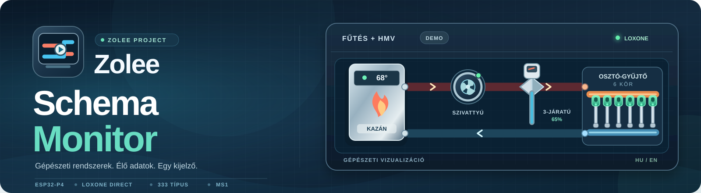
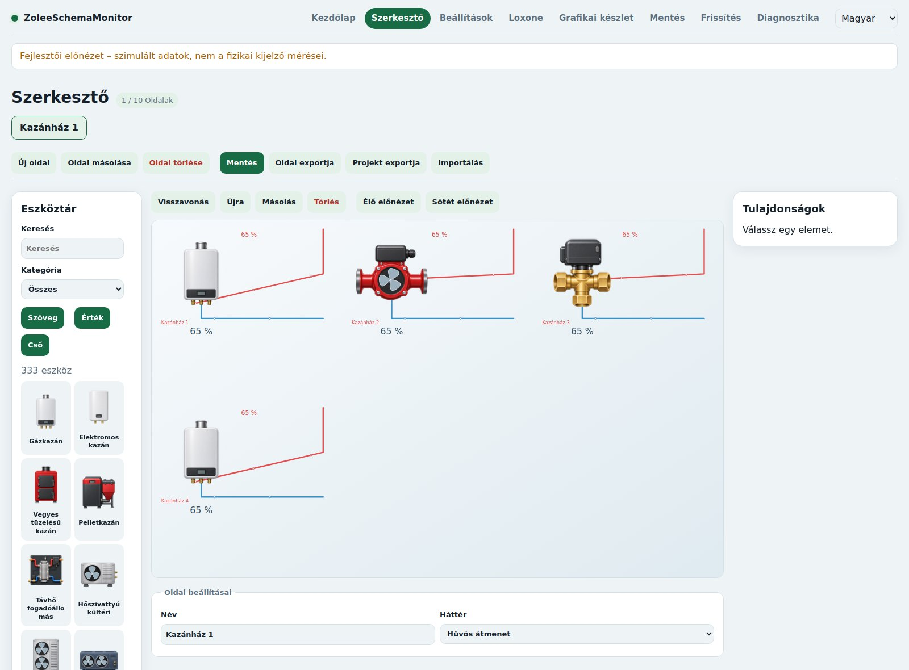
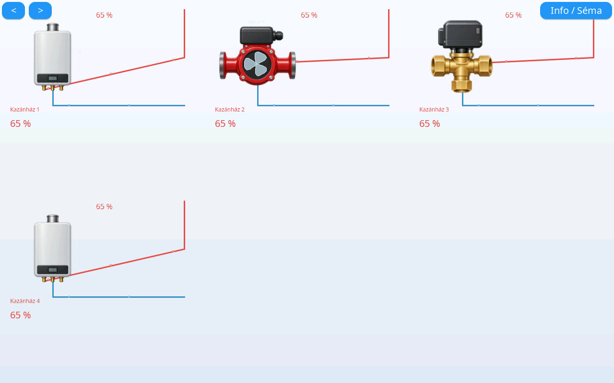

<h1 align="center"></h1>

  
  

**Zolee Schema Monitor** – önálló, animált, közvetlen Loxone-kapcsolatú gépészeti séma-kijelző a **Waveshare ESP32-P4-WIFI6-Touch-LCD-10.1 (SKU 33150)** érintőpanelhez. A PC-n használható webszerkesztővel fűtési, hűtési, HMV-, szellőzési, medence-, vízellátási és öntözőrendszerek rajzolhatók; a készülék a párosított Loxone-értékeket a sémán jeleníti meg.

**Állapot: MS1 fejlesztési ág – még nem lezárt, fizikai készüléken igazolt kiadás.** A szerkesztő, a teljes grafikai katalógus és több gazdagépes teszt működik; a valódi ESP32-P4/Miniserver-próbák, a 20 FPS cél mérése és a 24 órás járatás még hátra van. [MS1 elfogadási feltételek](doc/ms1.md) · [Aktuális hátralévő lista](doc/ms1-hatralevo.md).

## Az MS1 megvalósított funkciói

| Terület | Jelenlegi képességek |
| --- | --- |
| **Gépészeti eszközök** | **333 katalógustípus**, teljes grafikai bekötéssel: 322 PNG-s típus (319 használt képfájl) és 11 számított osztó; kazánok, hőszivattyúk, szelepek, szivattyúk, hőleadók, légtechnika, medence, öntözés, érzékelők. |
| **Kazánpaletta** | Gyártó szerinti HU/EN keresés; a Magyarországon jellemző gyártók képei és különféle fűtési, kombi, HMV-tárolós, illetve egyéb bekötési változatok. Gyártónként egy jellegzetes grafika használható több változathoz. |
| **PC-s webszerkesztő** | Legfeljebb **10 oldal**, oldalanként **150 elem**; húzás, méretezés, 90°-os lépésenkénti forgatás, kép-előnézet, rendezett tulajdonságpanel, visszavonás, mentés és oldal-/projektexport, import. |
| **Csövek és bekötések** | Színek, **1–30 px** csővastagság, csatlakozópontokra illeszkedés, áramlási irány; keresztezésnél **elkerülő ív vagy csomópont**, valamint T-leágazás. |
| **Osztó-gyűjtők** | Paraméterezhető **2–16 körös** fűtési/hűtési osztó, méretezhető termékfotó-alapú grafikával és körönkénti 0–100%-os termofejállapottal. |
| **Élő adatok és animáció** | Közvetlen **Loxone Gen2 / 17.x** kapcsolat, olvasható numerikus állapotok, állítható skálázás; animált szivattyúk, ventilátorok, szelepek, szórófejek és csőáramlás. Adathiány külön, ismeretlen állapot. |
| **Kijelző és rendszer** | Világos/sötét mód, HU/EN, négy tájolás, oldallapozás, diagnosztika, SD-állapottár, jelszavas eszközmentés, firmware-/grafikai frissítési folyamat. Fizikai ellenőrzés még szükséges. |

A Schema Monitor **nem** az Energy Flow Display Master/Slave, MQTT vagy kaputelefon funkcióinak átvétele: önálló, közvetlen Loxone-adatot olvasó gépészeti megjelenítő.

## Képek a tényleges szerkesztőből és az LVGL-rajzolóból

  
  

<em>Balra: böngészős szerkesztő. Jobbra: a gazdagépen futtatott, valódi firmware-rajzolóból exportált kijelzőkép – nem fizikai panelen készült fotó.</em>

[Hat összetett tesztprojekt és képernyőképek](tests/schemas/README.md) · [Animált készülékek összehasonlító videója](tests/schemas/animaciok/osszehasonlitas.mp4) · [Képes kazánpaletta](doc/grafika/latvanytervek/kazangyartok.jpg) · [Csőkeresztezések](doc/webfelulet.md#csőkeresztezés-és-leágazás).

## A webszerkesztő kipróbálása

A számítógépes előnézethez **Python 3.12** és **Node.js 22+** szükséges. A repo gyökeréből:

~~~sh
python3 -m pip install -r tools/requirements-assets.txt
python3 tools/build_assets.py
python3 tools/dev_server.py --demo
~~~

Nyisd meg: **http://127.0.0.1:8080/editor**. A `--demo` kapcsoló szimulált méréseket ad; sem a helyi előnézet, sem a benne látott animáció nem igazolja a paneles teljesítményt vagy a Loxone-kapcsolatot. A firmware önmagától nem generál élő Loxone-adatot. [Részletes fejlesztői leírás](doc/fejlesztes.md).

## Hardver és használat

| Tulajdonság | Érték / követelmény |
| --- | --- |
| **Célpanel** | **Waveshare ESP32-P4-WIFI6-Touch-LCD-10.1 (SKU 33150)** |
| Felbontás és tájolás | Natív 800×1280; fekvő 1280×800; 0° / 90° / 180° / 270° |
| Kommunikáció | Wi-Fi, közvetlen Loxone Miniserver Gen2 / 17.x |
| Adattárolás | FAT32 microSD, ellenőrzött grafikakészlet és tartós projekt |
| Képfrissítés | **20 FPS cél**, fizikai 150 elemes terhelési teszttel még igazolandó |
| Kezelés | Érintéses oldallapozás és diagnosztika; a szerkesztés PC-n történik |
| Megjelenítés | Magyar/angol, világos/sötét; nappali/éjszakai Loxone-párosítás |

Az első készülékes telepítéshez az **azonos CI-futásból** származó firmware-t és SD-grafikai csomagot használd. A jelenlegi MS1-artefaktum nem nyilvános GitHub Release. [Telepítés és helyreállítás](doc/keszulek.md) · [Mentés és visszaállítás](doc/mentes.md).

## Dokumentáció és MS1 állapot

- [MS1 – elkészült fejlesztések részletes összefoglalója](doc/ms1-fejlesztesek.md)
- [MS1 elfogadási lista](doc/ms1.md) és [konkrét hátralévő feladatok](doc/ms1-hatralevo.md)
- [Webszerkesztő, csőkeresztezés, áramlás és felhasználói élmény](doc/webfelulet.md)
- [2–16 körös osztó-gyűjtők és forgatás](doc/osztogyujtok.md)
- [Eszközkészlet, gyártói képek és csatlakozópontok](doc/grafika/teljes-bekotes.md)
- [Loxone, firmware és adattárolási architektúra](doc/architektura.md)
- [Fejlesztés és automatizált ellenőrzések](doc/fejlesztes.md)
- [Mért és még nem mért működés](doc/allapot.md)
- [Teljes dokumentáció](doc/README.md)
- [Verziótörténet és első kiadási tervezet](doc/verziotortenet/README.md)

Az előzményként szolgáló, külön fejlesztett projekt: [Zolee Energy Flow Display](https://github.com/ZoleeBB/ZoleeEnergyFlowDisplay). A képek illusztrációk, illetve külön jelzett gazdagépes tesztkimenetek; az MS1 még nem késztermék.
