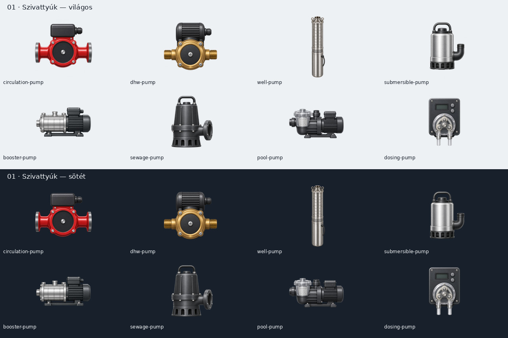
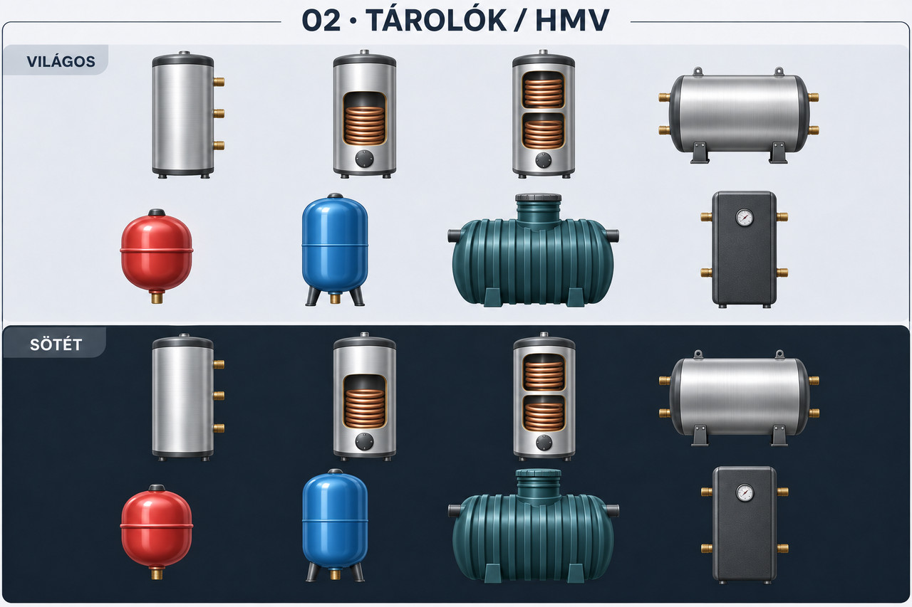

# Grafikai készlet és képméretek

A kiválasztott irány a **B: finoman térhatásos, egységes műszaki illusztráció**. A véglegesítés csoportonként történik: világos/sötét látványterv, felhasználói ellenőrzés, egyedi elemképek, majd bekötés és animációpróba. A látványterv nem vágólapként használt sprite sheet; a végleges elemképek külön, átlátszó vásznon készülnek.

## Első csoport: szivattyúk

**Állapot: a szivattyús stílus jóváhagyva. Az első 8 PNG-forrás bekötve 10 katalógustípushoz.**



A két panelen ugyanaz a nyolc fizikai kialakítás látszik. Balról jobbra, soronként:

| Hely | Kialakítás | Katalógusazonosító |
| --- | --- | --- |
| 1 | Karimás keringető | `circulation-pump`, fűtési alkalmazás: `heating-pump`, szolár alkalmazás: `solar-pump` |
| 2 | Kompakt bronz HMV-keringető | `dhw-pump` |
| 3 | Hosszú, csőkútba merülő kútszivattyú | `well-pump` |
| 4 | Fogantyús merülőszivattyú | `submersible-pump` |
| 5 | Vízszintes, többfokozatú nyomásfokozó | `booster-pump` |
| 6 | Széles nyomócsonkos szennyvízszivattyú | `sewage-pump` |
| 7 | Előszűrős medenceszivattyú | `pool-pump` |
| 8 | Perisztaltikus vegyszeradagoló | `dosing-pump` |

A fűtési és szolár alkalmazás azonos fizikai keringetőt is használhat; nem kap mesterségesen eltérő szivattyúházat pusztán a neve miatt. A típus és a felirat továbbra is külön katalóguselem.

A látványtervben szereplő forgórész csak a tervezett megjelenést jelzi. A végleges állóképbe nem kerülhet beforgatott animáció: a mozgó réteget a megjelenítő külön rajzolja. A középpontot, a csonkok helyét és az animáció fajtáját minden eltérő fizikai kialakításhoz külön kell beállítani; a jelenlegi általános pumpa-overlay nem tekinthető ezekre véglegesnek.

## Mi kerül a Gitbe?

| Cél | Hely | Formátum és méret | Fájlkorlát |
| --- | --- | --- | --- |
| Jóváhagyott futásidejű elemkép | `assets/elements/` | Átlátszó PNG, regisztrált 160×160 vászon | 128 KiB/kép |
| Csoportos dokumentációs látványterv | `doc/grafika/latvanytervek/` | Legfeljebb 1280×960, aránytartó JPEG vagy PNG | 2 MiB/kép |
| Nagy munkakép, félkész változat | `artwork-work/` vagy repón kívül | Nem verziózzuk | – |

A szivattyús terv tényleges tárolt mérete **1280×853**, körülbelül **176 KiB**. A nagy generált munkakép nem kerül a repóba. A dokumentációs JPEG nem része a panel grafikai csomagjának, nem foglal kijelzőmemóriát.

A 160×160 a jelenlegi PNG-készlet forrásvászna, nem az elem szerkesztőbeli méretkorlátja. A rajzra helyezett elem továbbra is méretezhető. Nagyított elemnél a raszter élességét valós panelen még ellenőrizni kell; nagyobb forrásméret csak mért igény és a memóriahatás felülvizsgálata után vezethető be.

## Előkészítés és automatikus ellenőrzés

```sh
python3 -m pip install -r tools/requirements-assets.txt
python3 tools/prepare_image.py artwork-work/pump.png assets/elements/light/circulation-pump.png --role element
python3 tools/prepare_image.py artwork-work/pumps-sheet.png doc/grafika/latvanytervek/01-szivattyuk.jpg --role preview
```

Az elemforrás négyzetes legyen, legalább 160×160 méretű. A segédprogram nem vág körbe, nem nyújt, nem nagyít fel kis forrást; a teljes vászon regisztrációja megmarad. LANCZOS kicsinyítést alkalmaz, megtartja az alfát és eltávolítja a munkametaadatokat. JPEG csak teljesen fedő dokumentációs látványtervhez engedélyezett.

Minden Gitbe kerülő rasztert pontos útvonallal, céllal és pixelmérettel fel kell venni a `catalog/image-sizes.json` jegyzékbe. Új felbontás nem engedélyezhető egyszerűen egy nagyobb szám beírásával: a program külön szerepkorlátot is ellenőriz.

```sh
git add catalog/image-sizes.json doc/grafika/latvanytervek/01-szivattyuk.jpg
python3 tools/image_policy.py
```

Az ellenőrzés a **Git-index tartalmát** olvassa, nem a munkapéldányt. Így ugyanazt vizsgálja helyben és a CI-ben, ami a commitba kerül. A nem jegyzett képet, a hiányzó jegyzett fájlt, az eltérő pixelméretet, a túl nagy fájlt és a hibás PNG-fejlécet elutasítja. A runtime elemkép csak PNG lehet; dokumentációban megengedett a kis JPEG is. Az SVG-források vektorosak, nem tartoznak a raszterjegyzékbe.

A generált `web/graphics/` és `dist/graphics/` készletek továbbra sem verziózott fájlok. A jelenlegi generátor 160×160 PNG-ket állít elő; a jóváhagyott egyedi képek átvételét és OTA-forrásazonosítóba kötését az alább leírt generátor végzi. Az első méretvédelmi változás még nem érintette az OTA-azonosítót; az egyedi képek alább leírt bekötése már igen.

## Bekötött szivattyúk és folytatás

A források `assets/elements/universal/` alatt vannak. Egy forrásból képződik a világos és sötét csomagútvonal; a hash szerinti deduplikáció így a témák és a valóban közös hardverkialakítások között is működik. A készülék nem tölt le két példányt ugyanabból a képből.

A keringető és HMV-keringető üres középső felületére külön mozgó rotor kerül. A zárt kútszivattyú, merülő-, nyomásfokozó-, szennyvíz-, medence- és adagolószivattyú pulzáló üzemjelzőt kap: aktív zöld, kikapcsolva szürke, ismeretlen adatnál borostyán. A teljesítményjel az ütemet is befolyásolja. Az animációk nem módosítják a PNG-t, és a frissítésükben nincs SD-olvasás vagy képenkénti memóriafoglalás.

A csonk- és animációkoordináták a firmware-katalógusban, az új vásznakhoz regisztrálva szerepelnek. Korábban tervezett oldal importjánál a csővégek illeszkedését ellenőrizni kell az új kialakításokon; nem végzünk automatikus, rejtett rajzátalakítást.

A generátor a kész PNG-ket átveszi, a további típusoknál megtartja a műszaki helyőrzőket. A natív katalógus és a webszerkesztő ugyanazokat a port- és animációadatokat kapja. Az OTA-forrásazonosító a PNG-k tartalmát és a grafikai függőségverziókat is lefedi. Az új teljes csomaghoz új firmware kell; a korábbi firmware-hez kötött készletek megmaradnak.

A minimum 300 eszközhöz **317 típus** van előkészítve. Ez nem 317 kész kép: [tételes készlet és állapot](keszlet.md). Következő csoportok: tárolók/HMV; hőtermelők; szelepek; hőleadók és hidraulika; légtechnika; medence; öntözés; érzékelők. Minden csoporthoz külön világos/sötét látványterv készül, a végleges képek további kis csomagokban kerülnek fel.

A teljes, jelenlegi PNG/SVG kiadási csomag 1239 bejegyzés, a manifest körülbelül 152 KiB, a logikai fájlméretek összege körülbelül 3,9 MiB. A fájlszámkorlát 2048 lett; a 256 KiB-os manifest-, 4 MiB/fájl- és 128 MiB összméretkorlát változatlan. A teljes csomag előállítható, az új egyedi rajzok készültségét ez nem helyettesíti.

[Gyártói tájékozódási pontok](forrasok.md).

## Második csoport: tárolók / HMV

**Állapot: a csoportterv bemutatva; az első 4 PNG-forrás már bekötve 5 tárolótípushoz. További 19 típus még helyőrzős.**



Balról jobbra: sima álló puffer, egyspirálos HMV tároló, kétspirálos tároló, fekvő puffer; alul fűtési tágulási tartály, hidrofor, bordázott esővíztároló, szögletes hőtároló. A további tárolóváltozatokat a tételes készlet tartalmazza. A metszeti ablak kizárólag az eszköz felismerhetőségét segíti; nem gyártói belső szerkezeti terv.


### 02/A képcsomag

Az álló puffer, az egyspirálos HMV-tároló, a kétspirálos tároló és a fekvő puffer 160×160-as, átlátszó PNG-je külön négyképes csomagban került a repóba. A `hot-water-tank` és `single-coil-tank` közös, ténylegesen azonos egyspirálos kialakítást használ. Ezek passzív eszközök, forgórész vagy pulzáló pumpajelző nélkül; a kívánt hőmérsékletek és állapotértékek külön értékmezőkkel helyezhetők el.

A jelenleg bekötött készültség **15 típus, 12 külön PNG-forrás**. A képkészítés azóta továbbhaladt: [gyártási állapot és további csoportlátványtervek](gyartasi-allapot.md). A forrásképek elkészülése és a futásidejű bekötés külön állapot; a 317-es katalógus nem kész 317-es képkészlet.

A firmware csomagolója minden típushoz világos és sötét PNG-t követel meg. A generált vektoros típusok SVG-jei is kötelezők; a kész PNG-forrásokhoz nem készítünk fölösleges SVG-burkolatot. Hiányzó téma, hiányzó szükséges SVG vagy váratlan fájl esetén a csomagolás elutasítja a készletet. A vegyes készlet ellenőrzését külön teszt fedi.
