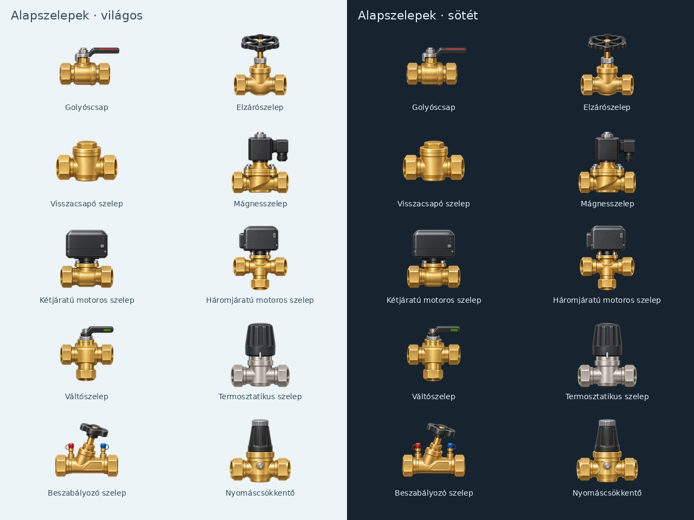

# Alapszelepek: tízes bekötési csomag

Tíz meglévő, felülvizsgált 160×160-as PNG kerül a futásidejű készletbe. Nem készültek új forrásképek és nem nőtt a katalógustípusok száma. A csonkok a végleges vászonhoz igazodnak; a világos és sötét nézet ugyanazt az átlátszó forrást használja.

| Azonosító | Típus | Vízoldali port |
| --- | --- | ---: |
| `ball-valve` | Golyóscsap | 2 |
| `shutoff-valve` | Kézi elzárószelep | 2 |
| `check-valve` | Visszacsapó szelep | 2 |
| `solenoid-valve` | Mágnesszelep | 2 |
| `motor-valve-2` | Kétjáratú motoros szelep | 2 |
| `motor-valve-3` | Háromjáratú motoros szelep | 3 |
| `diverting-valve` | Váltószelep | 3 |
| `thermostatic-valve` | Termosztatikus szelep | 2 |
| `balancing-valve` | Beszabályozó szelep | 2 |
| `pressure-reducer` | Nyomáscsökkentő | 2 |

A villamos tekercs, kábelcsatlakozó és motorház, a kézikerék és a beszabályozó piros/kék mérőcsonkjai nem köthetők vízcsőhöz. A képek statikusak; nincs rájuk rajzolt forgórész vagy visszajelzésként félreérthető mozgás. A csövek aktivitása és a külön értékmezők továbbra is önálló Loxone-forráshoz rendelhetők.

Az előnézet az aktuális `ARTWORK`-hozzárendelésekből újra előállítható: `python3 tools/build_valve_preview.py`.

## Korábbi sémák csőbekötése

A korábbi helyőrző csonkja eltérhet a végleges kép csonkjától. A forrás/cél elemazonosítóhoz és porthoz kötött cső végpontját ezért mindkét megjelenítő az aktuális csonkból számolja, az elem mérete és negyedfordulatos forgatása szerint. Ez minden kapcsolt eszközre, a paraméterezhető osztók 34 portjára is érvényes.

Csak a kötött végpont változik: a szabad vég és a köztes töréspontok megmaradnak. A böngésző az igazítást mentendő módosításként jelzi; a készülék a megjelenítéshez számolja ki, és önállóan nem írja át az SD-n lévő projektet. A számítás a jelenet felépítésekor történik, nem az animáció minden képkockájában. A natív jelenet egész pixeles koordinátái legfeljebb egy képponttal térhetnek el a böngésző tört koordinátáitól.

A regisztrált portok száma és elhelyezése, a mérőcsonkok kizárása, a régi csőkoordináták igazítása és a változatlan szabad vég regressziós ellenőrzést kapott. A gazdagépes modell- és LVGL-próba külön kezelendő a fizikai P4- és Miniserver-próbától; az MS1 továbbra is nyitott.

## Összesítés

333 katalógustípus; 82 típushoz bekötött kép 79 külön PNG-forrásból, továbbá egy paraméterezhető osztó-gyűjtő. 250 korábbi helyőrző integrációja még hátravan. A repóban lévő PNG-források száma változatlanul 331.
