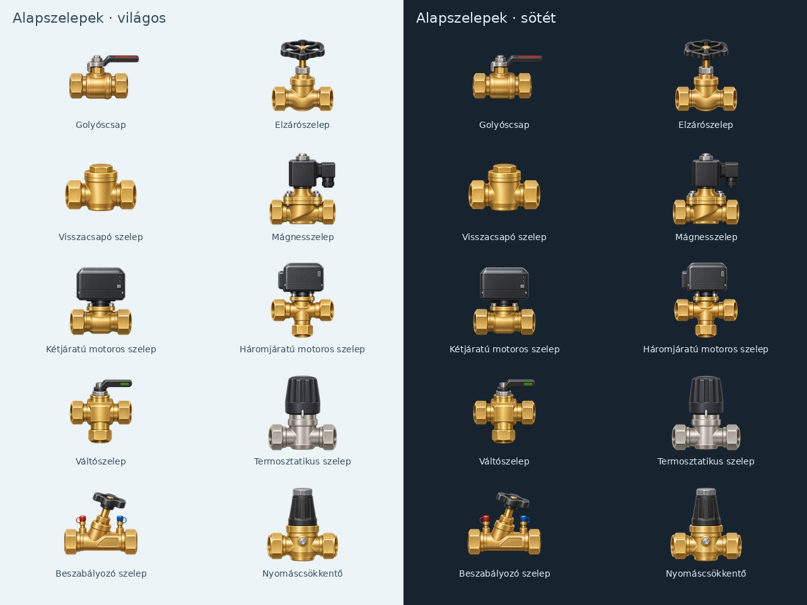

# Képkészítés állapota – 2026. november 6.

## Aktuális összesítés

**321 külön PNG-forrás a repóban, 333 bekötött katalógustípus, nulla helyőrző.** 322 típus 319 használt PNG-forrásból jelenik meg, további 11 osztógrafika pontos darabszámú számított rajz. A két megmaradó tartalék forgatómotoros PNG nem növeli a típusszámot. A tíz korábbi, nem következetes körszámú osztó-PNG törölve; helyettük a grafikai csomag készít pontos rajzot. [Öt ötvenes commit és összevont ellenőrzés](teljes-bekotes.md). A korábbi [vizuális audit](vizualis-felulvizsgalat.md) és CSV a csere előtti állapot történeti nyilvántartása. Fizikai panelpróba és FPS-mérés még szükséges.

Az alábbi táblázatok és bejegyzések a korábbi csomagok időrendben megőrzött állapotait mutatják.

A gyártás közben a végleges, kicsinyített forrásképek kerülnek fel kis csomagokban. A katalógushoz illesztés és az animációs rétegek regisztrálása kisebb csomagokban halad; az összevont ellenőrzés a teljes képkészlet elkészülte után következik. A forráskép megléte nem jelenti, hogy a firmware már ezt jeleníti meg.

| Csoport | Külön PNG-forrás | Lefedett katalógustípus | Állapot |
| --- | ---: | ---: | --- |
| Szivattyúk | 27 | 29 | Mind a 27 forrás / 29 típus bekötve; készülékes próba hátravan |
| Tárolók és HMV | 23 | 24 | Mind a 23 forrás / 24 típus bekötve; vizuális és készülékes próba hátravan |
| Hőtermelők, hőszivattyúk és hűtők | 31 | 31 | Minden forrás elkészült; bekötés később |
| Radiátorok, konvektorok és klímabeltérik | 12 | 12 | Minden forrás elkészült; bekötés később |
| Felületi hőleadók, körök és napkollektor | 7 | 7 | Minden forrás elkészült; bekötés később |
| Hidraulikai hőcserélők, egységek, osztók és szűrők | 36 | 36 | Minden forrás elkészült; bekötés később |
| Szelepek és visszafolyásgátlók | 42 | 42 | Minden forrás elkészült; bekötés később |
| Szellőzési ventilátorok | 12 | 12 | Minden ventilátorforrás elkészült; bekötés később |
| Légkezelők, hővisszanyerők és légkezelési modulok | 14 | 14 | Részben elkészült; bekötés később |
| **Összesen** | **204** | **207** | **Az eredeti katalógusból 57 típus bekötve; további 150 típushoz a PNG már megvan** |

Az induló katalógus 317 típust tartalmaz. A még hiányzó egyedi források száma 110. A három valódi közös kialakítás: a fűtési és szolár keringető a keringetőszivattyú képét, az egyspirálos tároló a HMV-tároló képét használja. Ezekkel a teljes készlet várhatóan 314 külön PNG-ből áll.

## Csoportlátványtervek

- [01 – Szivattyúk](latvanytervek/01-szivattyuk.jpg)
- [02 – Tárolók és HMV](latvanytervek/02-tarolok-hmv.jpg)
- [03 – Hőtermelők](latvanytervek/03-hotermelok.jpg)
- [04 – Hőleadók](latvanytervek/04-holeadok.jpg)
- [05 – Felületi hőleadók](latvanytervek/05-feluleti-holeadok.jpg)
- [06 – Szivattyúváltozatok](latvanytervek/06-szivattyuvaltozatok.jpg)
- [07 – Hidraulika](latvanytervek/07-hidraulika.jpg)
- [08 – Szelepek](latvanytervek/08-szelepek.jpg)
- [09 – Szellőzés és légtechnika](latvanytervek/09-szellozes-legtechnika.jpg)

A fűtés/hűtés kategória mind a 48 típusához, a tárolók mind a 24 típusához és az összes 29 szivattyútípushoz, továbbá a hidraulika kategória mind a 61 típusához megvan a képi alap. A források bekerültek a repóba; a további bekötés és animációpróba a teljes képkészlet után következik.

## Hátralévő képek

| Katalóguscsoport | Még hiányzó típus | Következő munka |
| --- | ---: | --- |
| Hidraulika | 0 | A teljes képi alap elkészült |
| Szelepek | 0 | A teljes képi alap elkészült |
| Szellőzés és légtechnika | 25 | A 12 ventilátor és 14 légkezelési modul kész; további gépváltozatok és légoldali szerelvények következnek |
| Medencetechnika | 27 | A szivattyúk és hőszivattyúk már elkészültek; a többi szerelvény még hátravan |
| Öntözés | 23 | Szórófejek, zónák és szerelvények |
| Érzékelők | 35 | Érték- és állapotérzékelők |
| **Összesen** | **110** | **A legalább 300 eszközös teljes induló készlet még nincs kész** |

## Műszaki felülvizsgálat és hátralévő bekötés

A távhő-fogadóállomás első rajzának hibás, a primer és szekunder oldalt külsőleg összekötő csövezése ki lett cserélve. A javított képen négy külön ág csatlakozik a hőcserélőhöz; a motoros szelep a primer visszatérő ágon van. A vezérlő vezetékei vékony fekete elektromos kábelek.

Az abszorpciós hűtő illusztrációja melegvíz-hajtású kialakítást jelöl: külön hőforrás-, hűtővíz- és hűtöttvíz-csatlakozópárral. A külső köröket nem köti össze díszcső. Gyártói tájékozódási alap: [Yazaki – vízhajtású abszorpciós hűtők](https://www.yazakienergy.com/waterfiredfeatures.htm). Az ikon nem gyártói szerelési rajz.

A ventilátoros gépek alapképein nincs beégetett lapát. A készlet bekötésekor a két- és háromventilátoros, illetve a felülnézetben ellipszisként látszó ventilátorokhoz külön mozgó réteg és pontos vászonkoordináta szükséges. A ventilátor nélküli beltéri és abszorpciós gépek nem kaphatnak általános forgó jelzést.

Az osztó-gyűjtők 2, 3, 4, 5, 6, 7, 8, 9, 10 és 12 körös változatban készültek el. A két fejléc között nincs beégetett csőkapcsolat; a köri csonkok a rögzítőelemek alól a szabad vászonba nyúlnak. A 12 körös változat bekötésekor összesen 26 csatlakozási pont szükséges (két fő és 24 köri); a firmware és a szerkesztő csatlakozókorlátját ehhez külön ellenőrizni kell. A leválasztók és szűrők szervizfedelei, illetve légtelenítő-sapkái nem tekinthetők nyitott vízcsatlakozónak. A metszeti ablakok szemléltetik a szűrőanyagot; az ikonok nem gyártói szerelési rajzok.

A Gitben a futásidejű források 160×160 pixeles, átlátszó PNG-k. A nagy munkaképek nincsenek verziózva. A csoportlátványtervek legfeljebb 1280×960 pixeles dokumentációs képek, nem részei az SD-csomagnak.

A felhasználó kérésére a képkészítés közben nem futtatunk teszteket és nem vizsgáljuk az Actions eredményeit; a képcsomag-commitok `[skip ci]` jelölést kapnak. Az összevont teszt, fordítás és grafikai integráció ellenőrzése még hátravan. A fizikai P4-mérés ettől külön feladat marad.

## Kiegészítés – forgatómotoros szelepek

További öt 160×160-as forráskép elkészült: összesen 209 PNG. Ezek új, a jelenlegi 317 típuson felüli változatjelöltek; a katalógusregisztrációjuk még hátravan, ezért a fenti lefedettségi táblázat nem számolja őket kész katalógustípusként. [Látványtervek és az élő mutató követelményei](forgatomotoros-szelepek.md).

## Ventilátorok animációs bekötése – hátralévő

A látható forgórészű ventilátorok alapképe sötét üres felületet tartalmaz; a lapátok külön futásidejű réteget igényelnek. A fali, cső-, befúvó, elszívó, radiál-, EC-, félradiális, füstelvezető és légrétegződést megszüntető változatnál a forgórész középpontját és két tengelyét képenként kell felvenni a végleges 160×160-as vásznon. A perspektivikus nyílások ellipszisek; kör alakú közös sablon nem feltétlenül illeszkedik. A doboz-, tető- és konyhai ventilátor járókereke zárt burkolat mögött van, ezek állapotjelzést igényelnek, nem kívülre rajzolt lapátokat. A csoportlátványterven látható lapátok szemléltető animációs rétegek. A Loxone-aktivitás, fordulatszámhoz igazított sebesség és adathiány viselkedésének bekötése, ellenőrzése még hátravan.

## Légkezelési modulok – hátralévő bekötés

A hővisszanyerős szellőztető, forgódobos, ellenáramú, keresztáramú és entalpiás modul négy külön légcsatlakozót igényel. A metszeti ablakok az alkatrészek felismerését szolgálják, nem gyártói szerelési rajzok. A forgódobos alap üres körfelületére külön forgó hőcserélőmátrix-réteg szükséges; ventilátorlapát nem használható helyette. A lemezes és membrános betétek nem forognak.

A kaloriferek két légcsatlakozója mellett két külön vízcsatlakozó van; a hűtőkaloriferen kondenzvíz-elvezető is található. A párásítón külön kis vízbetáp és ürítő van, a párátlanítón kondenzvízcsonk. A csonkok médiumát és pontos helyét az integrációkor képenként kell megadni. A rögzítőcsavarok és szervizfedelek nem csatlakozási pontok. Zárt burkolatú légkezelőre nem kerülhet kívül látható általános rotor.

## Következő képcsomag

A tető-légkezelő és befúvó légkezelő képe elkészült és felkerült. A decentralizált szellőztető és a moduláris légkezelő generálása szolgáltatói képgenerálási keretkorlátba ütközött, ezért ezekhez még nincs kész PNG. Folytatás: decentralized-heat-recovery, modular-air-handler, extract-air-unit, steam-humidifier; utána ultrasonic-humidifier és desiccant-dehumidifier, majd a légoldali szerelvények. A tető-légkezelő felső rotorhelyét perspektivikus, ellipszis alakú animációs réteghez kell bekötni.

## Forgatómotoros kiegészítések integrációja

A három fekete házas szelep a katalógusba és a két rajzolóba bekötve; a katalógus így 320 típusú. Az alapképek száma változatlanul 209. A korábbi, 317 típusra vonatkozó gyártási táblázat mellé három új, saját PNG-vel regisztrált típus került; a két szürke házas képi változat regisztrációja továbbra is hátravan. A futásidejű grafikával bekötött típusok száma 18, külön forrásaik száma 15. Ez kódállapot, nem tesztelt készülékes eredmény.

## Tartályok integrációja – második csomag

A villanybojler, zárt tágulási tartály, hidrofor és kombinált tároló meglévő forrása bekötve. A légszelepek és zárt szervizfedelek nem csatlakozók. A villanybojler két alsó vízcsonkot, a tágulási tartály és hidrofor egy-egy alsó vízcsonkot, a kombinált tároló négy oldalsó vízcsonkot kapott. Forgó animáció egyikre sem kerül. A csonkok vizuális illeszkedésének szerkesztős és készülékes próbája még szükséges.

A katalógus továbbra is 320 típusú, az elkészült források száma 209; a bekötés 22 típust fed le 19 külön PNG-ből. A tárolócsoportban így 9 típushoz 8 forrás van bekötve. Ez kódállapot, a tesztek és az Actions ellenőrzése továbbra is halasztva.

## Tartályok integrációja – harmadik csomag

A fűtési membrános és ivóvizes tágulási tartály, nyitott tágulási tartály és esővíztartály saját PNG-je bekötve. A membrános tartályokon csak a vízoldali csatlakozás köthető: a fűtésin alul, az ivóvizesen felül; az előtöltő légszelep kimarad. A nyitott és esővíztartály két-két külső csatlakozási pontot kapott, a belső úszószelep és a fedél nem külön vízcsonk. Nincs rájuk rajzolt forgó animáció.

Összesen 26 típushoz 23 külön forrás van bekötve; ebből 13 tárolótípushoz 12 PNG. A teljes forráskészlet változatlanul 209 képes. A tesztfuttatás, fordítás, Actions-ellenőrzés és fizikai illeszkedéspróba még hátravan.

## Tartályok integrációja – negyedik csomag

Az indirekt, tartály-a-tartályban, szolár és rozsdamentes HMV-tároló saját képe bekötve. Az indirekt, belső tartályos és rozsdamentes változat négy-négy, a szolártároló hat külső csatlakozási pontot kapott. A belső spirál rajza nem alakít ki beégetett külső csőkapcsolatot. A hőmérő, érzékelőhüvely és szervizfedél nem vízcsatlakozás; egyik képre sem kerül forgó animáció.

A bekötés összesen 30 típust fed le 27 külön PNG-ből; a tárolócsoportban 17 típushoz 16 forrás használható. A teljes kész PNG-forráskészlet továbbra is 209 képes. A generálás elkészült, de tesztek, fordítás, Actions-ellenőrzés és készülékes vizuális próba még nem történt.

## Tartályok integrációja – ötödik csomag

A szögletes puffer, rétegtárolós puffer, víztartály és kondenzátumgyűjtő négy meglévő grafikája bekötve. A szögletes puffer négy, a rétegtároló három szinten hat külön csatlakozót kapott. A víztartály egy látható alsó kivezetése köthető; a zárt fedél nem port. A kondenzátumgyűjtő két oldalsó és egy felső csonkja külön pont. Nincs külső összekötés vagy forgó réteg.

A bekötés 34 típust fed le 31 külön PNG-ből; a tárolócsoportban 21 típushoz 20 forrás van bekötve. A teljes forráskészlet változatlanul 209 képes. Tesztfuttatás, fordítás, Actions-ellenőrzés és készülékes vizuális próba még hátravan.

## Tartályok integrációja – hatodik csomag

A sóoldattartály, föld alatti ciszterna és hőszivattyús vízmelegítő bekötve, így a tárolócsoport mind a 24 típusa saját PNG-t használ, 23 külön forrásból. A sóoldattartály egy felső oldalsó kivezetést, a ciszterna két oldalsó végpontot kapott; a zárt fedelek kimaradnak. A vízmelegítőn két felső légcsatlakozó és két alsó oldalsó vízcsonk külön pont. A szerkesztő nem ellenőrzi a médiumok egyezését, és nem köt össze automatikusan semmilyen pontot. A ventilátor zárt burkolata miatt csak az előlapi állapotjelző animált, külső forgó lapát nincs.

Az összesített integráció 37 típust fed le 34 külön PNG-ből. A teljes katalógus 320 típusú, az elkészült forráskészlet változatlanul 209 képes. A fenti korábbi csomagbejegyzések történeti állapotok. A tesztek, fordítás, Actions-ellenőrzés és fizikai illeszkedéspróba továbbra is hátravan.

## Szivattyúváltozatok integrációja – első csomag

A végszívású, hosszú tengelykapcsolós és két többfokozatú (álló/fekvő) szivattyú meglévő képe bekötve. Két külön vízcsonkot kaptak; a villamos doboz és tengelykapcsoló nem vízcsatlakozó. A zárt burkolat miatt motorra helyezett állapotjelző van, külső rotor nincs. A jelző a meglévő futásidejű aktivitási logikát követi (aktív pulzálás, kikapcsolt és ismeretlen állapot).

Összesen 41 típushoz 38 külön forrás van bekötve, ebből 14 szivattyútípushoz 12 kép. A teljes PNG-forráskészlet 209 képes. Teszt, fordítás, Actions-ellenőrzés és fizikai illeszkedéspróba továbbra is hátravan.

## Szivattyúváltozatok integrációja – második csomag

A jet-, önfelszívó, dugattyús és membránszivattyú négy meglévő képe bekötve. A folyadékoldal mindegyiken két külön pont. A dugattyús gépen mindkettő a rézfejen van; a bal hajtótengely és felső fekete olajsapka kimarad. A membránszivattyún a felső és alsó gyűjtő folyadékcsatlakozó, a középső levegős szerelvény nem kerül a vízkörbe. Mindegyik gép állapotjelzőt kap, kívülre rajzolt mozgó géprész nélkül.

Összesen 45 típushoz 42 külön PNG van bekötve; a szivattyúcsaládban 18 típushoz 16 forrás. A teljes forráskészlet továbbra is 209 képes. A csatlakozókra vonatkozó tesztesetek bővültek, de a tesztfuttatás, fordítás, Actions-ellenőrzés és fizikai próba továbbra is halasztva.

## Szivattyúváltozatok integrációja – harmadik csomag

A fogaskerék-, kondenzvíz-, szennyvízátemelő és darálós szivattyú meglévő képe bekötve. Két-két folyadékoldali pontot és állapotjelzőt kaptak. A fogaskerék-szivattyún csak a két jobb oldali rézcsonk köthető, a bal tengely nem. A darálós egységen az elülső nyílás és felső könyök köthető, a lezárt alsó oldalsó sapka kimarad. A kétmotoros átemelő közös jelzője a teljes egység egyetlen aktivitásforrását követi, nem külön motorállapotokat.

Összesen 49 típushoz 46 külön PNG van bekötve, ebből 22 szivattyútípushoz 20 forrás. A teljes kész forráskészlet változatlanul 209 kép. Teszt, fordítás, Actions-ellenőrzés és fizikai próba továbbra is hátravan.

## Szivattyúváltozatok integrációja – negyedik csomag

A függőleges akna-, vízütéses, osztott házas és örvénykerekes szivattyú képe regisztrálva. Az akna- és örvénykerekes gépen az alsó szívónyílás és a nyomócsonk külön pont. Az osztott házas gépen csak a két oldalsó karima köthető, az elülső tengely nem. A vízütéses szivattyún két csőcsonk és a hulladékvíz-kilépés három külön végpont, a zárt légüst teteje kimarad. Állapotjelzője a hozzárendelt üzem/áramlás jelet jelzi, nem feltételez villanymotort. A hulladékvíz-kilépés nem menetes csőcsatlakozó; a pont a sémán az elfolyó ág jelölésére használható.

Összesen 53 típushoz 50 külön PNG van bekötve; a szivattyúcsalád 26 típusa 24 forrásból jelenik meg. Teszt, fordítás, Actions-ellenőrzés és fizikai illeszkedéspróba továbbra is hátravan.

## Szivattyúváltozatok integrációja – ötödik csomag

Az iker inline, membrános adagoló és szabályozható medenceszivattyú három meglévő képe bekötve. Mindegyiken két folyadékcsatlakozó és egy állapotjelző van. Az iker gép közös jelzője az egész egység egy hozzárendelt aktivitásjelét követi; két külön motorállapotot nem állít. A teljesítményhez igazított pulzálás és az adathiány-kezelés a meglévő futásidejű logika része. A zárt burkolatokra külső forgólapát nem kerül.

A szivattyúcsalád mind a 29 típusa saját képpel regisztrálva, 27 külön forrásból. Az összesített integráció 56 típust fed le 53 PNG-ből. A teljes katalógus 320 típus, a kész forráskészlet változatlanul 209 kép. A család teljes regisztrációját ellenőrző teszteset elkészült; futtatása, a fordítás, Actions-ellenőrzés és fizikai próba még hátravan.

## Hőcserélők integrációja – első csomag

A lemezes, forrasztott lemezes, tömítéses lemezes és cső-a-csőben hőcserélő négy meglévő forrása bekötve. Mindegyik négy külön külső végpontot kapott; a leszorító rudak, csavarok és tartólábak nem csatlakozók. A cső-a-csőben változat két tengelyirányú és két köpenyoldali csonkja külön pont. Nincs beégetett külső összekötés vagy forgó animáció. A csatlakozók nincsenek automatikusan párosítva, a sémát a felhasználó rajzolja meg.

Összesen 60 típushoz 57 külön PNG-forrás van bekötve. A teljes forráskészlet továbbra is 209 kép. A tesztesetek bővültek; tesztfuttatás, fordítás, Actions-ellenőrzés és készülékes próba még hátravan.

## Új szellőzési forrásképek – folytatás

Elkészült a decentralizált falátvezetéses hővisszanyerő, moduláris légkezelő és elszívó légkezelő három forrásképe. A Gitbe kizárólag 160×160-as átlátszó PNG kerül. A decentralizált egység kerámiabetétes metszetet mutat; a moduláris légkezelő két légoldali nyílással és két külön vízcsonkkal készült; az elszívó egységen két légcsatlakozó van. A ventilátorok zárt házban maradnak, külső lapát nincs. A metszeti ablakok szemléltető elemek, nem további légcsatlakozók.

A teljes forráskészlet most 212 PNG. Az eredeti katalógushoz még 107 típus képe hiányzik (szellőzés 22, medence 27, öntözés 23, érzékelők 35). A mostani három forrás még nincs a katalógushoz bekötve; a futásidejű integráció továbbra is 60 típus / 57 forrás. Következő képek: steam-humidifier, ultrasonic-humidifier, desiccant-dehumidifier, majd légoldali szerelvények. Tesztet és Actions-ellenőrzést nem futtattunk.

## Párásítás és párátlanítás – új forráscsomag

Elkészült a gőzös párásító, ultrahangos párásító és adszorpciós párátlanító három forrásképe. A gőzös készüléken egy felső gőzkivezetés, külön alsó vízbetáp és ürítő van; az ultrahangoson a párakivezetés és az oldalsó víz-/ürítőcsonk különálló. A párátlanító négy légnyílása a technológiai és regeneráló légágakhoz tartozik; nincs külső csőhíd vagy kitalált vízcsonk. A belső metszeti ablak nem külső csatlakozó. Az adszorpciós kerék a mostani képen statikus; külön animációs réteg még nem készült.

A három 160×160-as átlátszó PNG-vel összesen 215 forráskép van. Az eredeti katalógushoz még 104 típus képe hiányzik (szellőzés 19, medence 27, öntözés 23, érzékelők 35). Az új három kép katalógusbekötése hátravan; az integráció továbbra is 60 típus / 57 forrás. [Generálási leírások](promptok/parasitas-paratlanitas.md). Tesztet és Actions-ellenőrzést nem futtattunk.

## Légoldali szerelvények – első forráscsomag

Elkészült a kézi körzsalu, motoros többlamellás légzsalu és tűzcsappantyú három 160×160-as átlátszó PNG-je. A kézi körzsalu egy pillangólapot és külső állítókart kapott. A motoros négyszögletes zsalu lamellái párhuzamosak; a hajtómotor kívül, a tengelynél helyezkedik el. A tűzcsappantyú egy vastag sötét zárólappal, külön narancsos rugó-visszatérítéses hajtással és külső kioldóházzal különül el. Nincs külső légcsatornahíd vagy vízcsonk. Ezek szemléltető ikonok, nem gyártói szerelési rajzok; a lapok és mutatók most a forráskép részei, élő állásanimáció még nincs bekötve.

Összesen 218 forráskép készült el. Az eredeti katalógushoz még 101 típus képe hiányzik (szellőzés 16, medence 27, öntözés 23, érzékelők 35). A mostani képek katalógusbekötése hátravan; az integráció továbbra is 60 típus / 57 forrás. [Generálási leírások](promptok/legzsaluk.md). Tesztet és Actions-ellenőrzést nem futtattunk.

## Légoldali szerelvények – tízképes forráscsomag

A felhasználó kérésére innentől tíz új képet tartalmazó csomagokban folytatjuk. Elkészült: supply-terminal, extract-terminal, ceiling-diffuser, slot-diffuser, swirl-diffuser, weather-louver, acoustic-air-terminal, duct-junction, backdraft-damper, pressure-relief-damper. Mindegyik 160×160-as átlátszó PNG. Az örvénybefúvó résekből álló előlapja álló szerelvény, nem ventilátor. Az akusztikus elem metszete hangelnyelő bélést mutat; ez nem külön légnyílás. Az Y-elágazás három ágú. A visszacsapó és túlnyomás-kiegyenlítő zsaluk passzív szerelvények, villanymotor nélkül; az alapképek lapjai statikusak. A visszacsapó zsalu első változatának világos háttérfátyla külön képszerkesztéssel javítva.

Összesen 228 forráskép készült el. Az eredeti katalógushoz még 91 típus képe hiányzik (szellőzés 6, medence 27, öntözés 23, érzékelők 35). A mostani tíz kép katalógus- és animációs bekötése hátravan; az integráció továbbra is 60 típus / 57 forrás. [Generálási leírások](promptok/legtechnika-10-es-csomag.md). Tesztet és Actions-ellenőrzést nem futtattunk.

## Szellőzés lezáró forrásai és medencetechnika – tízképes csomag

Elkészült a fan, vav-box, constant-air-regulator, circular-vav, rectangular-vav, smoke-damper, sand-filter, cartridge-filter, uv-disinfection és salt-electrolysis tíz 160×160-as átlátszó PNG-je. A ventilátor üres forgórészhelyet kapott, a mozgó réteg később készül. A VAV nyomásvezetékei nem légcsatlakozók; a négyszögletes változat hibás, két mérőcsonkot összekötő csőhurka két külön házoldali mérőpontra vezető csőre javítva. A lapok és mérőműszerek most statikusak.

A homokszűrő különálló tartály, a váltószelep nem része ennek a típusnak. A patronos szűrő metszete belső betétet mutat. Az UV-egység két felső vízcsonkja különbözik a zárt tengelyirányú lámpafedéltől; a sóbontócella két vízoldali hollanderét a felső villamos fedél nem köti össze. A képek szemléltető ikonok, nem gyártói szerelési rajzok. [Medencetechnikai csoportlátványterv](latvanytervek/10-medencetechnika.jpg); a látványterv nem része az SD-csomagnak, és a végleges ikonok eltérhetnek tőle. [Generálási leírások](promptok/szellozes-medence-10-es-csomag.md).

Összesen 238 forráskép készült el. A szellőzés mind az 51 típusának van saját forrásképe, a futásidejű bekötés még hátravan. Az eredeti katalógushoz még 81 típus képe hiányzik (medence 23, öntözés 23, érzékelők 35). Az integráció továbbra is 60 típus / 57 forrás. Tesztet és Actions-ellenőrzést nem futtattunk.

## Medenceszerelvények és élményelemek – tízképes csomag

Elkészült: skimmer, pool-inlet, bottom-drain, pool-light, counter-current, deck-jet, waterfall, massage-jet, pool-bubbler, chlorine-feeder. Mindegyik 160×160-as átlátszó PNG. A szkimmer billenőajtójának első, hibás felső csuklója alsó csuklóra javítva, a fenékürítő első változatának világos háttérfátyla eltávolítva. A lámpa villamos tömszelencéje nem vízcsatlakozó. A masszázsbefúvón a nagyobb víz- és kisebb levegőbetáp különálló. A klóradagoló két alsó vízcsatlakozót kapott külső csőhíd nélkül; a tablettákat szemléltető metszet nem külső nyílás. A vízesés, peremfúvóka és levegőbefúvó képe nem tartalmaz beégetett víz- vagy buborékanimációt. A rajzok szemléltető ikonok, nem gyártói szerelési rajzok.

Összesen 248 forráskép készült el. Az eredeti katalógushoz még 71 típus képe hiányzik (medence 13, öntözés 23, érzékelők 35). Az új képek katalógus- és animációs bekötése hátravan; az integráció továbbra is 60 típus / 57 forrás. [Generálási leírások](promptok/medence-szerelvenyek-10-es-csomag.md). Tesztet és Actions-ellenőrzést nem futtattunk.

## Medenceszűrők, szelepek és takarók – tízképes csomag

Elkészült: multiport-valve, automatic-multiport-valve, top-mount-sand-filter, side-mount-sand-filter, diatomaceous-filter, ozone-generator, balance-tank, pool-cover, solar-pool-cover, pool-bypass. Mindegyik 160×160-as átlátszó PNG. A felsőszelepes szűrő vízcsonkjai a szelepen vannak; az oldalszelepesen két külön rövid cső köti a szelepet a tartályhoz, három külső szelepcsonk szabad. A kovaföldszűrő metszete szűrőrácsokat mutat, nem patronbetétet. Az ózonegység kis gázcsonkjai nem vízcsatlakozók. A kiegyenlítő tartály három külön csonkot kapott, zárt fedele nem csatlakozó. A takarók motoros lamellás és kézi buborékfóliás kivitelben készültek, beégetett mozgás nélkül.

A bypass két T-elágazást, három szelepet és négy szabad csatlakozóvéget tartalmaz. A piros karos változat háttérmaradványai miatt a végleges ikon új, grafitszürke karos változat lett, azonos csőtopológiával. A képek szemléltető ikonok, nem gyártói szerelési rajzok; a mutatók és szelepek most statikusak.

Összesen 258 forráskép készült el. Az eredeti katalógushoz még 61 típus képe hiányzik (medence 3, öntözés 23, érzékelők 35). Az új képek katalógus- és animációs bekötése hátravan; az integráció továbbra is 60 típus / 57 forrás. [Generálási leírások](promptok/medence-szurok-takarok-10-es-csomag.md). Tesztet és Actions-ellenőrzést nem futtattunk.

## Medencealapok és öntözési szórófejek — tízképes csomag

Elkészült: pool, overflow-pool, spa, rotor-sprinkler, spray-sprinkler, micro-sprinkler, rotary-nozzle, impact-sprinkler, drip-line, dripper. Mindegyik 160×160-as átlátszó PNG. A szkimmeres medencén külön vízszint és szkimmernyílás látszik; a feszített víztükrűn körbefutó túlfolyórács. A spa külön ülőhelyeket és masszázsfúvókákat kapott. A rotoros és spray szórófej külön fúvókakialakítású; a mikroszórófejen oldalsó tömlőcsonk van. A forgó fúvóka önálló patron. A csepegtetőcsövön integrált kibocsátónyílások, két szabad csővég, külső csőhíd nélkül; a pontcsepegtető külön elem. A túlfolyós medence első nem négyzetes, háttérfátylas változata és a csepegtetőcső első háttérfátylas változata nem került a repóba; a szkimmeres medence éleihez javító generálás készült.

Az öntözési csoport [látványterve](latvanytervek/11-ontozestechnika.jpg) a gyártás előtt bemutatva. A látványterv stílusminta; nem csőkapcsolási terv és nem futásidejű elemkép.

Összesen 268 forráskép készült el. Az eredeti katalógushoz még 51 típus képe hiányzik (öntözés 16, érzékelők 35). A medencetechnika valamennyi eredeti típusához van forráskép. Az új képek katalógus- és animációs bekötése hátravan; az integráció továbbra is 60 típus / 57 forrás. [Generálási leírások](promptok/medence-ontozes-10-es-csomag.md). Tesztet és Actions-ellenőrzést nem futtattunk.

## Öntözési szelepek és csatlakozók — tízképes csomag

Elkészült: irrigation-valve, master-valve, angle-irrigation-valve, latching-irrigation-valve, quick-coupling-valve, compressor-port, valve-box, garden-tap, hose, fertigation-injector. Mindegyik 160×160-as átlátszó PNG. Az egyenes műanyag és réztestű szelepek két tengelyazonos vízcsatlakozóval, a sarokszelep alsó betáppal és oldalsó kimenettel készült. A bistabil szelep piros tekercse a katalóguson belüli megkülönböztetést segíti, nem gyártói színszabvány. A kompresszoradapter vízoldali menete és levegős csatlakozója külön látható. A zöld fedeles gyorscsatlakozó szelep kulcs nélkül szerepel. A szelepdoboz nyitott, üres belsejű; alsó kivágásai nem vízcsonkok. A kerti csap két csatlakozós; a tömlő két szabad végén külön csatlakozó van. A Venturi-bekeverő két vízportot és egy középső szívócsonkot kapott, külső csőhíd nélkül. A Venturi és a kompresszoradapter első nem négyzetes munkaképe helyett új négyzetes változat készült; nyújtás vagy vágás nem történt.

Összesen 278 forráskép készült el. Az eredeti katalógushoz még 41 típus képe hiányzik (öntözés 6, érzékelők 35). Az új képek katalógus- és animációs bekötése hátravan; az integráció továbbra is 60 típus / 57 forrás. [Generálási leírások](promptok/ontozes-szelepek-10-es-csomag.md). Tesztet és Actions-ellenőrzést nem futtattunk.

## 21 képes gyártás — 1. hétképes rész

Elkészült: irrigation-zone, bubbler-emitter, drip-tape, porous-hose, irrigation-hydrant, irrigation-controller, temperature-sensor. Mindegyik 160×160-as átlátszó PNG. Az öntözési zóna három szórófeje egy közös vezetékre csatlakozik. A lapos csepegtetőszalag és a porózus szivárogtató tömlő külön képet kapott, beégetett víz nélkül. Az öntözővíz-csatlakozón külön látszik a doboz, a fedél és a vízbetáp. A vezérlő kijelzője üres; kábelbevezetései nem vízcsatlakozók. A hőmérőszonda és villamos csatlakozója külön kivehető. Az érzékelőcsoport látványtervét gyártás előtt bemutattuk.

Összesen 285 forráskép készült el. Az eredeti katalógushoz még 34 típus képe hiányzik, mind az érzékelőcsoportban. Az öntözési csoport valamennyi eredeti típusához van forráskép. Az új képek katalógus- és animációs bekötése hátravan; az integráció továbbra is 60 típus / 57 forrás. [Generálási leírások](promptok/21-kep-1.md). Tesztet és Actions-ellenőrzést nem futtattunk.

## 21 képes gyártás — 2. hétképes rész

Elkészült: pressure-sensor, flow-sensor, water-meter, heat-meter, level-sensor, humidity-sensor, co2-sensor. Mindegyik 160×160-as, átlátszó PNG. A nyomástávadó villamos DIN-csatlakozója nem vízport; az átfolyásmérő és vízóra két tengelyazonos folyadékcsatlakozót kapott. A hőmennyiségmérő két külön hőmérőszondával látható, külső hidraulikai átkötés nélkül. A szintkapcsoló úszója statikus. A falérzékelők és mérők kijelzőjén nincs beégetett érték. A rajzok szemléltető ikonok, nem szerelési rajzok.

Összesen 292 forráskép készült el; még 27 érzékelőkép hiányzik. A megkezdett 21 képes csomagból 14 kész. A futásidejű integráció továbbra is 60 típus / 57 forrás. [Generálási leírások](promptok/21-kep-2.md). A képelőkészítés és méretjegyzék hat célzott gazdagépes tesztje sikeres; firmware-fordítás és fizikai panelpróba nem történt.

## 21 képes gyártás — 3. hétképes rész, csomag lezárva

Elkészült: ph-sensor, redox-sensor, rain-sensor, soil-moisture-sensor, leak-sensor, frost-sensor, filter-pressure-switch. Mindegyik 160×160-as, átlátszó PNG. A pH-üveggömb és a redoxszonda kis fémelektródája különbözik. A talajszonda három egyenes mérőrudat, a szivárgásérzékelő két alsó érintkezőt kapott. A fagyvédelmi kapcsoló kapillárisa és érzékelővége zárt, nem vízcsatlakozó. A szűrő nyomáskapcsolóján két külön tömlőcsonk van, külső összekötés nélkül. A képeken nincs beégetett mérési érték vagy effekt.

Az első kör nem négyzetes, feliratos vagy háttérfátylas változatai helyett új generálás készült; vágás és nyújtás nem történt. A repóba csak a végleges kis képek kerültek. Összesen 299 forráskép kész; a teljes forráskészletből még 20 érzékelőkép hiányzik. A megkezdett 21 képes csomag mindhárom hétképes része elkészült. [Generálási leírások](promptok/21-kep-3.md). A hat célzott képelőkészítési/méretjegyzék-teszt és a Git-index képméret-ellenőrzése sikeres. Firmware-fordítás és fizikai panelpróba nem történt; az új képek katalógus- és animációs bekötése hátravan.

## Érzékelők — hőmérséklet és nyomáskülönbség, tízképes csomag

Elkészült: outdoor-temperature-sensor, duct-temperature-sensor, immersion-temperature-sensor, strap-on-temperature-sensor, infrared-temperature-sensor, room-temperature-sensor, combined-climate-sensor, air-differential-pressure-sensor, water-differential-pressure-sensor, differential-temperature-sensor. Mindegyik 160×160-as, átlátszó PNG. A csőre szerelt érzékelő nyitott bilincse nem folyadékport. A vízoldali differenciálnyomás-távadó két külön menetes nyomáscsatlakozót, a légoldali két külön tömlőcsonkot kapott. A hőmérséklet-különbség mérő két önálló szondája két külön kábellel kapcsolódik a készülékhez; az első, hibás kábelágazású munkakép helyett új generálás készült. Nincs beégetett számérték vagy mutató.

Összesen 309 forráskép kész; még 10 érzékelőkép hiányzik. A futásidejű integráció továbbra is 60 típus / 57 forrás. [Generálási leírások](promptok/erzekelok-homerseklet-nyomas-10.md). A hat célzott képelőkészítési/méretjegyzék-teszt sikeres; firmware-fordítás és fizikai panelpróba nem történt.

## Érzékelők — áramlás, vízminőség és gáz, záró tízképes csomag

Elkészült: ultrasonic-flow-meter, magnetic-flow-meter, turbidity-sensor, conductivity-sensor, salinity-sensor, free-chlorine-sensor, dissolved-oxygen-sensor, carbon-monoxide-sensor, air-velocity-sensor, gas-meter. Mindegyik 160×160-as, átlátszó PNG. Az ultrahangos és elektromágneses mérő külön kialakítást kapott. A zavarosságmérő két optikai ablaka egymással szemben áll; a vezetőképesség-szonda két fém elektródát, az induktív sótartalom-szonda átmenő nyílású érzékelőgyűrűt mutat. A klórszonda membrános, az oldottoxigén-szonda optikai érzékelővégű. A légsebességmérő védett mérőeleme álló, nem ventilátor. A gázmérő két külön felső csatlakozót kapott. A vezetőképesség-szonda első, a vászon széléig érő kábele helyett teljes kábelt és csatlakozót mutató új generálás készült. Nincs beégetett számérték, folyadék vagy animációs effekt.

**A forrásképek gyártása teljes: 319 külön PNG található a repóban, és a katalógus mind a 320 típusához elérhető forrás.** A lefedettség-ellenőrzés a már regisztrált ARTWORK-hozzárendeléseket, a többi típusnál a stabil azonosítóval egyező PNG-t vizsgálta; hiányzó típus nincs. Ez a meglévő fájlok ellenőrzése, nem automatikus futásidejű bekötés. A futásidejű integráció továbbra is 60 típus / 57 forrás; a további 260 típus bekötése és animációs regisztrációja hátravan. [Generálási leírások](promptok/erzekelok-vizminoseg-gaz-10.md).

Ellenőrzés: az új húsz kép pontosan 160×160-as RGBA PNG, üres háttérrel és teljesen fedő tárgyrészekkel; a hat célzott képelőkészítési/méretjegyzék-teszt sikeres. A Git-index képméret- és méretkorlát-ellenőrzése sikeres. A firmware-fordítás, az összevont animációs regresszió és a fizikai P4-próba még hátravan; az MS1 mérföldkő nyitott marad.

## Tíz alapszelep futásidejű bekötése

A golyóscsap, elzárószelep, visszacsapó, mágnesszelep, két- és háromjáratú motoros szelep, váltószelep, termosztatikus szelep, beszabályozó és nyomáscsökkentő meglévő képe bekötve. Nyolc kétjáratú és két háromjáratú típus; a kezelőszervek és a beszabályozó két mérőcsonkja nem vízport. A tíz kép statikus; nem rajzolunk rájuk kitalált külső forgórészt.

