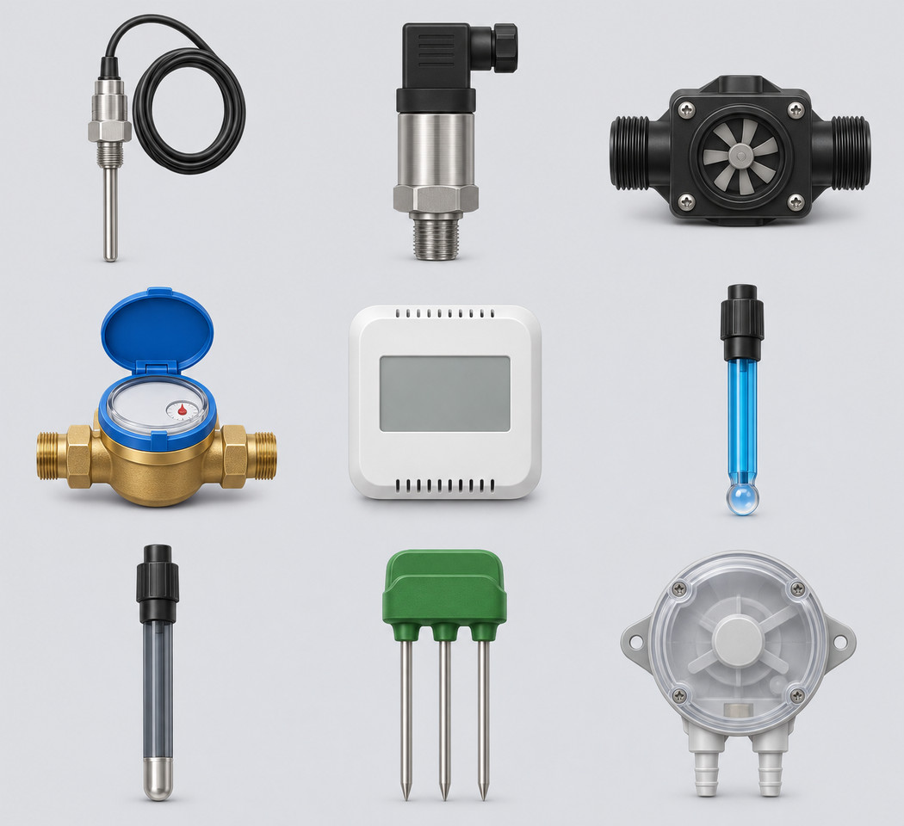

# 21 képes gyártás — 1. rész

A beépített képgenerátorral készült, 160×160-as átlátszó PNG-k. Az eredeti munkaképek nem kerülnek a repóba. A rajzok szemléltető ikonok, nem gyártói szerelési rajzok. A katalógus- és animációs bekötés későbbi feladat.

## Érzékelőcsoport látványterve

A gyártás előtt bemutatott stílusminta. A végleges mérőképek nem tartalmaznak beégetett mérési értéket. A látványterv nem csőkapcsolási terv.

Use case: stylized-concept. A polished building services sensor equipment concept sheet for Zolee Schema Monitor, opaque pale gray background, tidy 3 by 3 grid with generous gaps. Nine distinct unconnected product illustrations: stainless wired temperature probe; threaded stainless pressure transducer with black DIN plug; black inline turbine flow sensor; brass inline water meter with blue register; white wall air-quality sensor with blank screen; blue pH electrode with round glass bulb tip; graphite ORP electrode with platinum tip; green soil moisture sensor with three straight metal rods; circular differential air pressure switch with two separate hose barbs. Cohesive softly dimensional technical style, near frontal slightly elevated view, crisp silhouettes, realistic restrained materials, readable at small size. No words, digits, logos, measurements, connecting pipes or wires between separate objects, no people. This is a style preview, not a connection diagram.

## irrigation-zone

Use case: stylized-concept. Asset type: single building-services equipment icon for a 160x160 display library. Cohesive polished softly dimensional technical product illustration, near frontal slightly elevated view, restrained realistic materials, crisp clear silhouette and broad readable features. Center one complete isolated object on a SQUARE transparent canvas, roughly 82 percent coverage with safe margins. Genuine alpha transparency all around and through open gaps. No floor, shadow plane, background fog, environment, grass, typography, logo, labels, watermark, arrows, water sprays or animated effects. Static technical hardware. One compact irrigation zone assembly consisting of a horizontal short black polyethylene distribution pipe with two open threaded union ends at left and right. Exactly three small vertical black popup sprinkler heads on three distinct short tees along this single pipe, each head has a slim raised riser and cap. Dry simplified equipment group icon, no water, no terrain, no invisible loops. Three heads visibly join one common pipe, no controller or valves.

## bubbler-emitter

Use case: stylized-concept. Asset type: single building-services equipment icon for a 160x160 display library. Cohesive polished softly dimensional technical product illustration, near frontal slightly elevated view, restrained realistic materials, crisp clear silhouette and broad readable features. Center one complete isolated object on a SQUARE transparent canvas, roughly 82 percent coverage with safe margins. Genuine alpha transparency all around and through open gaps. No floor, shadow plane, background fog, environment, grass, typography, logo, labels, watermark, arrows, water sprays or animated effects. Static technical hardware. One irrigation bubbler emitter, short black plastic cylindrical stem with a broad adjustable dark green slotted round cap. Single small threaded male water inlet at the bottom. The cap has broad radial openings for low-flow bubbling, no jet stream. Compact squat hardware, no stake or pipe or droplets.

## drip-tape

Use case: stylized-concept. Asset type: single building-services equipment icon for a 160x160 display library. Cohesive polished softly dimensional technical product illustration, near frontal slightly elevated view, restrained realistic materials, crisp clear silhouette and broad readable features. Center one complete isolated object on a SQUARE transparent canvas, roughly 82 percent coverage with safe margins. Genuine alpha transparency all around and through open gaps. No floor, shadow plane, background fog, environment, grass, typography, logo, labels, watermark, arrows, water sprays or animated effects. Static technical hardware. One short length of flat black irrigation drip tape with a subtle thin blue longitudinal stripe, curved gently into a shallow arc with both open flattened oval ends clearly visible. Exactly four discrete tiny inline emitter slits spaced along one upper face, no external drippers, no water, no reel or coiled bundle. Flattened tape section visibly distinct from round hose.

## porous-hose

Use case: stylized-concept. Asset type: single building-services equipment icon for a 160x160 display library. Cohesive polished softly dimensional technical product illustration, near frontal slightly elevated view, restrained realistic materials, crisp clear silhouette and broad readable features. Center one complete isolated object on a SQUARE transparent canvas, roughly 82 percent coverage with safe margins. Genuine alpha transparency all around and through open gaps. No floor, shadow plane, background fog, environment, grass, typography, logo, labels, watermark, arrows, water sprays or animated effects. Static technical hardware. One short dark charcoal porous rubber soaker hose bent into a broad U with two separate open ends at lower left and lower right. Coarse microporous rubber texture clearly distinct from smooth drip tubing. No drilled large emitter holes, no external drippers, no attached connectors, no leaking water or ground.

## irrigation-hydrant

Use case: stylized-concept. Asset type: single building-services equipment icon for a 160x160 display library. Cohesive polished softly dimensional technical product illustration, near frontal slightly elevated view, restrained realistic materials, crisp clear silhouette and broad readable features. Center one complete isolated object on a SQUARE transparent canvas, roughly 82 percent coverage with safe margins. Genuine alpha transparency all around and through open gaps. No floor, shadow plane, background fog, environment, grass, typography, logo, labels, watermark, arrows, water sprays or animated effects. Static technical hardware. One compact underground irrigation water socket assembly: a short black cylindrical plastic access housing with green circular hinged lid open, brass quick water coupling socket visible recessed inside, and one short horizontal black inlet fitting projecting from the lower right side. No removable key or hose installed. A single socket enclosure, no terrain, no second hidden outlet.

## irrigation-controller

Use case: stylized-concept. Asset type: single building-services equipment icon for a 160x160 display library. Cohesive polished softly dimensional technical product illustration, near frontal slightly elevated view, restrained realistic materials, crisp clear silhouette and broad readable features. Center one complete isolated object on a SQUARE transparent canvas, roughly 82 percent coverage with safe margins. Genuine alpha transparency all around and through open gaps. No floor, shadow plane, background fog, environment, grass, typography, logo, labels, watermark, arrows, water sprays or animated effects. Static technical hardware. One wall-mount irrigation controller enclosure, light gray rectangular body with softly rounded corners, blank dark LCD upper left and one large gray selector dial upper right, four small green buttons below screen, closed cover. Two dark cable glands along bottom edge, no water fittings, no wires or text or digits, no brand. Compact front three-quarter view.

## temperature-sensor

Use case: stylized-concept. Asset type: single building-services equipment icon for a 160x160 display library. Cohesive polished softly dimensional technical product illustration, near frontal slightly elevated view, restrained realistic materials, crisp clear silhouette and broad readable features. Center one complete isolated object on a SQUARE transparent canvas, roughly 82 percent coverage with safe margins. Genuine alpha transparency all around and through open gaps. No floor, shadow plane, background fog, environment, grass, typography, logo, labels, watermark, arrows, water sprays or animated effects. Static technical hardware. One general-purpose wired temperature probe: slim stainless steel cylindrical sealed probe with rounded closed tip pointing down, black strain relief and short black cable gently arcing upward. Cable ends in a small two-pin plug, no extra probes. Single simple industrial sensor, no dial, water fittings, labels or numbers.
