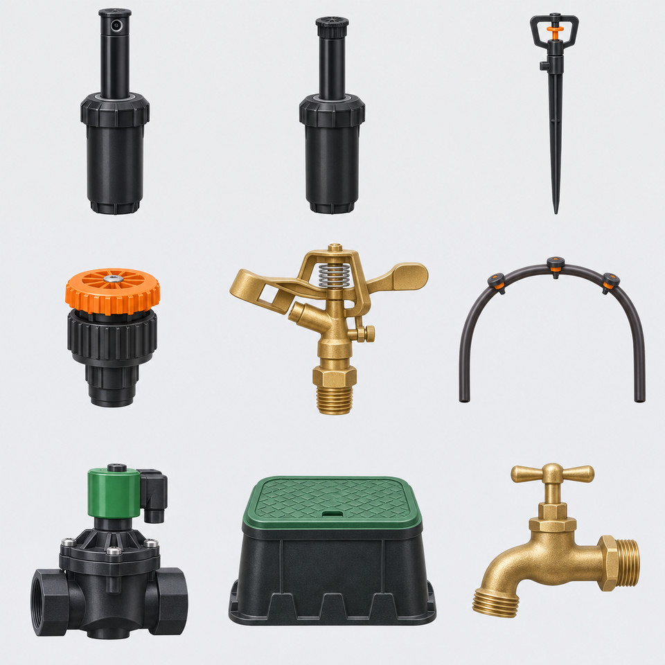

# Medencék és öntözési szórófejek — 10 képes csomag

Készült a beépített képgenerátorral. A gyártási képek 160×160-as, átlátszó PNG-k; az eredeti munkaképek nem kerülnek a repóba. A képek szemléltető ikonok, nem gyártói szerelési rajzok. A vízsugár és mozgás későbbi, külön animációs réteg.

## Öntözési csoport látványterve

Use case: stylized-concept. A polished irrigation equipment library concept sheet for Zolee Schema Monitor. Opaque very pale grey background, tidy 3 by 3 grid of isolated small technical product illustrations, with generous gaps. Nine objects: black popup rotor sprinkler raised; black fixed spray popup sprinkler; slender stake micro sprinkler; black rotary nozzle with orange cap; brass impact sprinkler; a neat U-shaped drip tube with small integrated emitters; black solenoid irrigation valve with green top; green lidded rectangular valve box; brass garden tap. Same cohesive softly dimensional technical illustration style, near frontal slightly elevated view, crisp silhouettes, restrained realistic materials, readable at small size. Static dry hardware, no water sprays, no soil, no grass, no attached plumbing network, no people, no words, no logos, no numbering. This is a style preview, not a connection diagram.

## pool

Use case: stylized-concept. Asset type: single building-services equipment icon for a 160x160 display library. Cohesive polished softly dimensional technical product illustration, near frontal slightly elevated view, restrained realistic materials, crisp clear silhouette and broad readable features. Center one complete isolated object on a square transparent canvas, roughly 82 percent coverage with safe margins. Genuine alpha transparency all around and through open gaps. No floor, shadow plane, environment, grass, typography, logo, labels, watermark, arrows, water sprays or animated effects. Static technical hardware. A rectangular skimmer swimming pool basin, white rim and light blue interior with calm flat turquoise water below the rim. Show a shallow isometric basin cutaway with solid white exterior side walls and two small recessed circular wall return outlets; a distinct dark rectangular skimmer opening high on one short wall above water level. No building, deck, surrounding pipes or people. Water level below rim, unlike an overflow pool.
Edit: Clean up this same pool illustration only: remove the detached white flakes, white halo and all white pixel clusters floating outside the true white basin rim, particularly above the back edge and below the bottom edge. Preserve basin geometry, recessed dark skimmer opening, side return fittings, water and square composition exactly. Real transparent background with crisp antialiased edge and no floor or shadows. Keep square canvas.

## overflow-pool

Use case: stylized-concept. Asset type: single building-services equipment icon for a 160x160 display library. Cohesive polished softly dimensional technical product illustration, near frontal slightly elevated view, restrained realistic materials, crisp clear silhouette and broad readable features. Center one complete isolated object on a square transparent canvas, roughly 82 percent coverage with safe margins. Genuine alpha transparency all around and through open gaps. No floor, shadow plane, environment, grass, typography, logo, labels, watermark, arrows, water sprays or animated effects. Static technical hardware. A rectangular overflow swimming pool basin in shallow isometric view, white slim perimeter edge and turquoise calm water flush with the inner rim. A clearly distinct continuous pale gray grated overflow gutter all around outside the inner rim, enclosed by the outer wall. Solid clean white basin side walls. No skimmer opening, no external plumbing, no building or deck or people.
Edit: Edit this overflow pool illustration. Preserve its basin, flat water level and continuous perimeter overflow grating. Remove ALL the gray background fog and cast shadow; make every pixel outside the actual hardware fully transparent with clean crisp edges. Put the complete object centered with generous margin on a SQUARE 1024 by 1024 transparent canvas, without stretching the object. No extra objects, text, floor or glow.

## spa

Use case: stylized-concept. Asset type: single building-services equipment icon for a 160x160 display library. Cohesive polished softly dimensional technical product illustration, near frontal slightly elevated view, restrained realistic materials, crisp clear silhouette and broad readable features. Center one complete isolated object on a square transparent canvas, roughly 82 percent coverage with safe margins. Genuine alpha transparency all around and through open gaps. No floor, shadow plane, environment, grass, typography, logo, labels, watermark, arrows, water sprays or animated effects. Static technical hardware. A compact square freestanding whirlpool spa tub, rounded white rim, dark graphite exterior skirt, pale blue molded interior seats visible beneath still shallow turquoise water. Several small circular recessed massage jet fittings in the interior seat backrests, no bubbles, no people, no external pipes or environment. Control panel a small blank dark rectangle on the rim.

## rotor-sprinkler

Use case: stylized-concept. Asset type: single building-services equipment icon for a 160x160 display library. Cohesive polished softly dimensional technical product illustration, near frontal slightly elevated view, restrained realistic materials, crisp clear silhouette and broad readable features. Center one complete isolated object on a square transparent canvas, roughly 82 percent coverage with safe margins. Genuine alpha transparency all around and through open gaps. No floor, shadow plane, environment, grass, typography, logo, labels, watermark, arrows, water sprays or animated effects. Static technical hardware. One black irrigation pop-up rotor sprinkler shown raised, substantial lower cylindrical housing, threaded bottom water inlet, slimmer raised riser and rotatable cylindrical head with one single clearly visible round side jet orifice near its upper rim. No fan spray slit, no water spray. Dry hardware.

## spray-sprinkler

Use case: stylized-concept. Asset type: single building-services equipment icon for a 160x160 display library. Cohesive polished softly dimensional technical product illustration, near frontal slightly elevated view, restrained realistic materials, crisp clear silhouette and broad readable features. Center one complete isolated object on a square transparent canvas, roughly 82 percent coverage with safe margins. Genuine alpha transparency all around and through open gaps. No floor, shadow plane, environment, grass, typography, logo, labels, watermark, arrows, water sprays or animated effects. Static technical hardware. One black irrigation fixed-spray pop-up sprinkler shown raised. Cylindrical lower housing, threaded bottom water inlet, slim raised riser, compact adjustable flat top cap with a distinct narrow horizontal fan nozzle slit directly below cap. Clearly a fixed spray head, no large rotor side orifice, no water.

## micro-sprinkler

Use case: stylized-concept. Asset type: single building-services equipment icon for a 160x160 display library. Cohesive polished softly dimensional technical product illustration, near frontal slightly elevated view, restrained realistic materials, crisp clear silhouette and broad readable features. Center one complete isolated object on a square transparent canvas, roughly 82 percent coverage with safe margins. Genuine alpha transparency all around and through open gaps. No floor, shadow plane, environment, grass, typography, logo, labels, watermark, arrows, water sprays or animated effects. Static technical hardware. One black irrigation micro sprinkler on a slender pointed ground stake. Small open protective bridge above the tiny orange rotating spinner at the very top, narrow vertical riser and one small side hose barb near its lower middle. Entire stake visible; dry hardware, no attached hoses.

## rotary-nozzle

Use case: stylized-concept. Asset type: single building-services equipment icon for a 160x160 display library. Cohesive polished softly dimensional technical product illustration, near frontal slightly elevated view, restrained realistic materials, crisp clear silhouette and broad readable features. Center one complete isolated object on a square transparent canvas, roughly 82 percent coverage with safe margins. Genuine alpha transparency all around and through open gaps. No floor, shadow plane, environment, grass, typography, logo, labels, watermark, arrows, water sprays or animated effects. Static technical hardware. One compact irrigation multi-stream rotary nozzle cartridge, black stepped cylindrical body with threaded lower male inlet, orange adjustment cap above black knurled collar, small metallic central adjustment screw. Only nozzle cartridge, no popup housing, no water, no lettering.

## impact-sprinkler

Use case: stylized-concept. Asset type: single building-services equipment icon for a 160x160 display library. Cohesive polished softly dimensional technical product illustration, near frontal slightly elevated view, restrained realistic materials, crisp clear silhouette and broad readable features. Center one complete isolated object on a square transparent canvas, roughly 82 percent coverage with safe margins. Genuine alpha transparency all around and through open gaps. No floor, shadow plane, environment, grass, typography, logo, labels, watermark, arrows, water sprays or animated effects. Static technical hardware. One brass impact irrigation sprinkler head, dry static hardware. A single brass angled jet nozzle points left, hinged spring-loaded impact arm immediately in front of the nozzle, exposed silver torsion spring at pivot, sturdy brass body and threaded male inlet below. Two small arc-limit wire stops around lower spindle. No water, no base tripod.

## drip-line

Use case: stylized-concept. Asset type: single building-services equipment icon for a 160x160 display library. Cohesive polished softly dimensional technical product illustration, near frontal slightly elevated view, restrained realistic materials, crisp clear silhouette and broad readable features. Center one complete isolated object on a square transparent canvas, roughly 82 percent coverage with safe margins. Genuine alpha transparency all around and through open gaps. No floor, shadow plane, environment, grass, typography, logo, labels, watermark, arrows, water sprays or animated effects. Static technical hardware. One short black irrigation inline-emitter drip tube bent into a wide shallow inverted U, with two distinct circular open cut ends facing down at left and right. Exactly three small discrete integrated emitter outlet dots along the tube exterior, no external orange mushroom drippers. Constant tube diameter, no crossover or closed ring. No water, no fittings.
Edit: Remove the entire gray foggy background of this drip tube. Keep ONLY the solid black U-shaped tube and its three emitter outlet holes, with a crisp clean edge. Every pixel outside the actual tube must have zero alpha, both outside the arch and inside the arch. No floor or shadow or glow, do not add any white background. Preserve tube shape and its two open cut ends. Square transparent canvas.

## dripper

Use case: stylized-concept. Asset type: single building-services equipment icon for a 160x160 display library. Cohesive polished softly dimensional technical product illustration, near frontal slightly elevated view, restrained realistic materials, crisp clear silhouette and broad readable features. Center one complete isolated object on a square transparent canvas, roughly 82 percent coverage with safe margins. Genuine alpha transparency all around and through open gaps. No floor, shadow plane, environment, grass, typography, logo, labels, watermark, arrows, water sprays or animated effects. Static technical hardware. One irrigation adjustable point-source drip emitter shown enlarged as a standalone object: compact black round mushroom body, orange knurled adjustable top cap, a short tapered hose insertion barb below, small side drip outlet. No tube or stake, no water, no markings.
