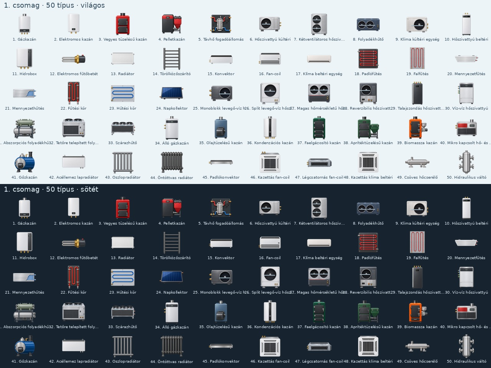

# Teljes grafikai bekötés: öt ötvenes csomag

Elkészült csomag: **1/5**. A kiinduló 250 helyőrzőből 50 típus bekötve; 200 maradt. A katalógus továbbra is 333 típus.

Aktuális készlet: **132 típus egyedi PNG-vel, 129 külön használt PNG-forrásból; 1 számított osztógrafika**. A két tartalék forgatómotoros PNG nem külön katalógustípus.

A hőtermelők, hőleadók és légtechnikai készülékek rejtett hátoldali kötéseit sematikus pont jelöli; ez nem a képre rajzolt új alkatrész. Az ilyen esetek megjegyzése az `artwork-bindings.json` fájlban és a katalógus `portNote` mezőjében található. Gáz-, füstgáz- és villamos csatlakozó nem kerül a hidraulikai pontok közé. A későbbi lég- és hűtőközeg-pontok saját közeget jelentenek; a szerkesztő továbbra sem végez médium szerinti kompatibilitás-ellenőrzést.

A többventilátoros képek minden nyitott rotorhelye külön mozgó réteget kap, közös készülékaktivitással. Ez nem több külön motor visszajelzése. Zárt házra nem kerül kitalált külső forgórész. Ismeretlen adat nem jelent kikapcsolt állapotot.

A régi, rögzített körszámú osztók képein a körök száma nem minden esetben volt pontos. A család tíz képe kikerül; helyettük csomagoláskor pontos darabszámú, kódból előálló műszaki grafika készül. A korábbi alsó körportok sorrendje megmarad, az új előremenő portok utánuk következnek. A körönkénti élő termofej-állapothoz a szabadon paraméterezhető **Termofejes osztó-gyűjtő (2–16 kör)** használható; a régi típusok statikus képek.

Az automatizált ellenőrzések a felhasználó kérésére csak mind az öt csomag után, összevontan futnak. A köztes commitok nem tekinthetők ellenőrzött kiadásnak. Fizikai P4-/Miniserver-próba és FPS-mérés továbbra is szükséges; az MS1 nyitott.

## 1. csomag

