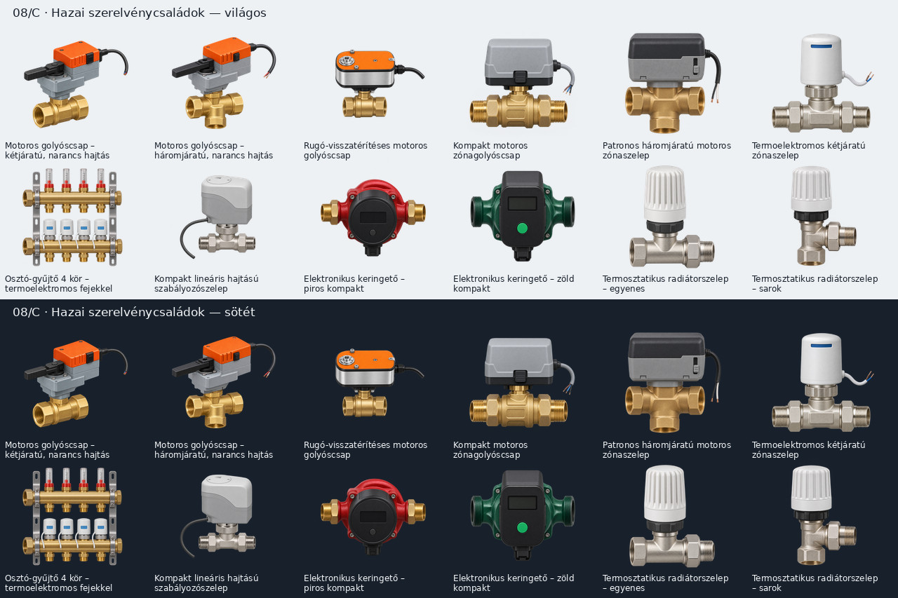

# Teljes vizuális felülvizsgálat — 2026. november 6.

A felülvizsgálat kiindulópontja a `2026b6161bac382e0baac9465dc4acf82212f376` commit: **319 külön elemkép és 14 dokumentációs látványterv**. Az összes elemképet világos és sötét háttéren, a kétes kialakításokat nagyítva is átnéztük. A tételes jegyzék minden eredeti képhez döntést és előtte/utána SHA-256 lenyomatot tartalmaz.

**Eredmény: 8 elemkép lecserélve, 12 új típus és kép hozzáadva. Összesen 331 PNG-forrás, 332 katalógustípus.** A 12 új típus képpel és a látható vízcsatlakozókhoz igazított portokkal be van kötve. A többi 260 korábbi helyőrző integrációja külön feladat. A 72 bekötött típus 69 külön forrást használ. A képkészlet és a fizikai P4-teszt készültsége nem azonos.

## Módszer és értelmezés

Az ellenőrzés a felismerhető készülékformára, az eszközcsaládhoz illő szerelvényekre, a külön közegek csatlakozóira, a csőhálózat folytonosságára, a körszámra és a fantázia-összekötésekre terjedt ki. Az elfogadott képek egyszerűsített műszaki illusztrációk, nem pontos gyártói CAD-modellek. A metszeti ablak szemléltető kivágás. A mozgó réteg számára üresen hagyott ventilátor/rotorhelyet a jegyzék külön jelzi; annak kész megjelenését a későbbi animációs integrációban is vizsgálni kell. Nem állítjuk, hogy minden egyes illusztráció egyetlen konkrét gyári rendelési szám másolata.

A hazai kínálathoz való igazítást gyártói magyar dokumentumok és magyar forgalmazói termékoldalak alapján végeztük. A lista termékcsalád-lefedettség, **nem eladási statisztika vagy bizonyított „legkeresettebb” rangsor**. Az elektronikus keringetők, motoros golyóscsapok, patronos zónaszelepek, termoelektromos hajtások és fehér fejű radiátorszelepek korábbi hiányait pótolja.

## Lecserélt képek

| Forrás | Hiba vagy félreérthetőség és javítás |
| --- | --- |
| `well-pump` | A korábbi kép zárt felső végéről hiányzott a felismerhető nyomócsonk. Új: nyitott felső nyomócsonk, emelőfülek, fokozatház, középső szívórács és alsó motor. A bekötött portok igazítva. |
| `wall-heating` | A korábbi párhuzamos oszlopos rajz radiátorra hasonlított. Új: falpanelre rögzített, egyetlen folytonos PEX kígyó, két szabad véggel. |
| `cooling-circuit` | A korábbi kép bordás kalorifer volt, nem felülethűtési kör. Új: egyetlen folytonos kék csőkígyó két végponttal. |
| `pool-bypass` | A korábbi két felső vég lezártnak látszott. Az elágazások elhelyezése helyes volt; az új képen mind a négy csatlakozó egyértelműen nyitott, a három szelep a megfelelő ágakon van. |
| `differential-pressure-valve` | A korábbi impulzuscső a saját szeleptesthez tért vissza. Új: külön távoli mérési ponthoz vezethető, szabad csatlakozóvégű kapilláris. |
| `rain-sensor` | A korábbi árnyékolótányéros forma hőmérőházra hasonlított, vezetéke a konzolhoz tért vissza. Új: állítható, esőt beengedő gyűjtőfej és szabad kábelvég. |
| `diatomaceous-filter` | A korábbi betétek nehezen különültek el a patronoktól. Új: radiálisan rendezett, íves sík szűrőrácsok; két vízcsatlakozó; a kivágás szemléltető metszet. |
| `overflow-pool` | A korábbi képen a túlfolyórács nem volt felismerhető. Új: vízszintbe simuló, négy oldalon végigfutó réselt túlfolyórács. |

A korábbi képek helyét a stabil PNG-útvonalon az új generálások vették át; az elvetett munkaképek nem kerültek a repóba. A kútszivattyú portjai az új felső nyomócsonkhoz és a szívórácshoz lettek igazítva, az alsó zárt motorvég nem vízcsatlakozó. A hibás részleteket tartalmazó 01 és 05 látványtervet a végleges ikonokból összeállított, világos/sötét ellenőrző lap váltotta fel. A további 12 korábbi terv megmaradt; nem mindegyikükben szerepel az összes új változat.

## Hazai termékcsaládok és új grafikai elemek

| Termékcsalád / formai tájékozódási alap | Új grafika |
| --- | --- |
| Belimo R2/R3 + LR | `orange-motor-ball-valve-2`, `orange-motor-ball-valve-3` |
| Belimo LRF rugó-visszatérítés | `spring-return-ball-valve-2` |
| Caleffi 6442 kompakt motoros zónagolyóscsap | `compact-motor-ball-valve-2` |
| Resideo / Honeywell Home VC patronos zónaszelep | `cartridge-zone-valve-3` |
| Caleffi 656 / 676 termoelektromos szelep és osztó | `electrothermal-zone-valve-2`, `electrothermal-manifold-4` |
| Siemens SSA kompakt lineáris hajtás | `compact-linear-control-valve-2` |
| Grundfos ALPHA / Wilo PICO jellegű kompakt elektronikus keringető | `red-ecm-circulation-pump`, `green-ecm-circulation-pump` |
| Danfoss RA-N / fehér mechanikus termosztátfej, egyenes és sarok | `radiator-thermostatic-valve-straight`, `radiator-thermostatic-valve-angle` |

A korábbi menetes, hollanderes és karimás fekete forgatómotoros háromjáratú szelepek az ESBE jellegű családot már lefedik; független élő állásrétegük megmaradt. A mostani új képek nem viselnek gyártói logót. A vezetékek és kézi oldókarok nem kapnak vízcsatlakozót; a zárt ECM-keringetőkön állapotjelzés, nem külső forgó lapát szerepel.

## Ellenőrzési jegyzékek

- [Minden kép tételes döntése és SHA-256 lenyomata](vizualis-felulvizsgalat.csv)
- [A kiválasztott új generálások leírásai](promptok/vizualis-felulvizsgalat.md)
- [Futásidejű bekötési állapot](keszlet.md)

## Gyártói és hazai tájékozódási alapok

- [Belimo LR24A — gyári adatlap és termékkép](https://www.belimo.com/mam/general-documents/datasheets/en-gb/belimo_LR24A_datasheet_en-gb.pdf)
- [Belimo LRF24-SR — gyári adatlap és termékkép](https://www.belimo.com/mam/general-documents/datasheets/en-gb/belimo_LRF24-SR_datasheet_en-gb.pdf)
- [Belimo R2025-S2 — magyar termékoldal](https://www.belimo.com/at/shop/hu_HU/Szab%C3%A1lyoz%C3%B3szelepek/Goly%C3%B3scsapok/R2025-S2/p?code=R2025-S2)
- [Belimo LR24A — magyar forgalmazói kínálat](https://mullerautomatikashop.hu/spd/LR24A/BELIMO-LR24A)
- [ESBE VRG130 + ARA600 — magyar gyártói oldal](https://esbe.eu/hu/termekek/kever%C5%91-egys%C3%A9gek/vrg130-ara600-3-pontos)
- [Resideo VC — magyar telepítői útmutató](https://homecomfort.resideo.com/resources/Shared%20Documents/hu-HU/Brochures/VC_VALVES_INSTALLERS_GUIDEBOOK_B2B_BROCHURE_A4_HUNGARY.pdf)
- [Resideo VC6013 — magyar kínálat](https://www.megatherm.hu/honeywell-vc6013-allito-motor-vc-szelephez)
- [Caleffi 6442 motoros golyóscsap](https://www.caleffi.com/en-int/motorised-two-way-ball-zone-valve-6442-caleffi-644242)
- [Caleffi 656 thermoelektromos hajtás](https://www.caleffi.com/en-int/thermo-electric-actuator-6561-caleffi-656102)
- [Caleffi 664 osztó-gyűjtő](https://www.caleffi.com/en-int/pair-of-manifolds-664-caleffi-664621)
- [Siemens SSA — gyári adatlap és termékkép](https://sid.siemens.com/api/khub/documents/kUByr2ioFQul28l_5Apwbg/content)
- [Wilo Yonos PICO — magyar gyártói oldal](https://wilo.com/hu/hu/Term%C3%A9kek/hu/termekek/yonos-pico_id199/4215521)
- [Grundfos — magyar búvárszivattyú-katalógus](https://api.grundfos.com/literature/Grundfosliterature-443905.pdf)
- [Danfoss Redia — magyar termosztátfej-adatlap](https://assets.danfoss.com/documents/latest/453940/AI419834775790hu-HU0102.pdf)
- [Danfoss RA-N sarokszelep — magyar kínálat](https://www.gepeszbolt.hu/sarok-kivitel/31328-danfoss-ra-n-sarok-termosztatikus-radiatorszelep-1-2-normal-terfogataram-dn-15.html)
- [Danfoss ASV — távoli impulzuscsöves szabályozópár](https://www.danfoss.com/en/products/dhs/valves/hydronic-balancing-and-control/automatic-balancing-valves/asv-automatic-balancing-valves/)
- [Uponor — magyar felületfűtési és hűtési rendszerek](https://www.uponor.com/hu-hu/termekeink/hu-feluletfutes-es-felulethutes)
- [Systemair — magyar légkezelő-választék](https://www.systemair.com/hu-hu/termekek/legkezelo-berendezesek)
- [Pentair FNS Plus — íves D.E.-szűrőrácsok](https://www.pentair.com/en-us/pool-spa/products/filters/fns-plus-filters.html)
- [Rain Bird RSD — esőérzékelő](https://www-app.rainbird.com/products/rsd-series-rain-shut)
- [Hunter MP Rotator — forgó fúvókacsalád](https://www.hunterirrigation.com/en-metric/irrigation-product/mp-rotator/standard-mp-rotator-nozzle)

## Minden elemkép döntése

| Forrás | Döntés | Megjegyzés |
| --- | --- | --- |
| `gas-boiler` | megtartva | A hőtermelő/hőleadó alapforma felismerhető, látható alkatrészei a kategóriával összeegyeztethetők; nem konkrét gyári modellmásolat. |
| `electric-boiler` | megtartva | A hőtermelő/hőleadó alapforma felismerhető, látható alkatrészei a kategóriával összeegyeztethetők; nem konkrét gyári modellmásolat. |
| `solid-fuel-boiler` | megtartva | A hőtermelő/hőleadó alapforma felismerhető, látható alkatrészei a kategóriával összeegyeztethetők; nem konkrét gyári modellmásolat. |
| `pellet-boiler` | megtartva | A hőtermelő/hőleadó alapforma felismerhető, látható alkatrészei a kategóriával összeegyeztethetők; nem konkrét gyári modellmásolat. |
| `district-heating` | megtartva | A hőtermelő/hőleadó alapforma felismerhető, látható alkatrészei a kategóriával összeegyeztethetők; nem konkrét gyári modellmásolat. |
| `heat-pump` | animációs alapkép | A hőtermelő/hőleadó alapforma felismerhető, látható alkatrészei a kategóriával összeegyeztethetők; nem konkrét gyári modellmásolat. A sötét/üres forgórészhely csak külön mozgó réteggel teljes; önálló termékfotóként nem értelmezendő. |
| `heat-pump-dual` | animációs alapkép | A hőtermelő/hőleadó alapforma felismerhető, látható alkatrészei a kategóriával összeegyeztethetők; nem konkrét gyári modellmásolat. A sötét/üres forgórészhely csak külön mozgó réteggel teljes; önálló termékfotóként nem értelmezendő. |
| `chiller` | animációs alapkép | A hőtermelő/hőleadó alapforma felismerhető, látható alkatrészei a kategóriával összeegyeztethetők; nem konkrét gyári modellmásolat. A sötét/üres forgórészhely csak külön mozgó réteggel teljes; önálló termékfotóként nem értelmezendő. |
| `air-conditioner-outdoor` | animációs alapkép | A hőtermelő/hőleadó alapforma felismerhető, látható alkatrészei a kategóriával összeegyeztethetők; nem konkrét gyári modellmásolat. A sötét/üres forgórészhely csak külön mozgó réteggel teljes; önálló termékfotóként nem értelmezendő. |
| `heat-pump-indoor` | megtartva | A hőtermelő/hőleadó alapforma felismerhető, látható alkatrészei a kategóriával összeegyeztethetők; nem konkrét gyári modellmásolat. |
| `hydrobox` | megtartva | A hőtermelő/hőleadó alapforma felismerhető, látható alkatrészei a kategóriával összeegyeztethetők; nem konkrét gyári modellmásolat. |
| `electric-heater` | megtartva | A hőtermelő/hőleadó alapforma felismerhető, látható alkatrészei a kategóriával összeegyeztethetők; nem konkrét gyári modellmásolat. |
| `radiator` | megtartva | A hőtermelő/hőleadó alapforma felismerhető, látható alkatrészei a kategóriával összeegyeztethetők; nem konkrét gyári modellmásolat. |
| `towel-radiator` | megtartva | A hőtermelő/hőleadó alapforma felismerhető, látható alkatrészei a kategóriával összeegyeztethetők; nem konkrét gyári modellmásolat. |
| `convector` | megtartva | A hőtermelő/hőleadó alapforma felismerhető, látható alkatrészei a kategóriával összeegyeztethetők; nem konkrét gyári modellmásolat. |
| `fan-coil` | megtartva | A hőtermelő/hőleadó alapforma felismerhető, látható alkatrészei a kategóriával összeegyeztethetők; nem konkrét gyári modellmásolat. |
| `air-conditioner-indoor` | megtartva | A hőtermelő/hőleadó alapforma felismerhető, látható alkatrészei a kategóriával összeegyeztethetők; nem konkrét gyári modellmásolat. |
| `underfloor-heating` | megtartva | A hőtermelő/hőleadó alapforma felismerhető, látható alkatrészei a kategóriával összeegyeztethetők; nem konkrét gyári modellmásolat. |
| `wall-heating` | lecserélve | A korábbi párhuzamos oszlopos rajz radiátorra hasonlított. Új: falpanelre rögzített, egyetlen folytonos PEX kígyó, két szabad véggel. |
| `ceiling-heating` | megtartva | A hőtermelő/hőleadó alapforma felismerhető, látható alkatrészei a kategóriával összeegyeztethetők; nem konkrét gyári modellmásolat. |
| `ceiling-cooling` | megtartva | A hőtermelő/hőleadó alapforma felismerhető, látható alkatrészei a kategóriával összeegyeztethetők; nem konkrét gyári modellmásolat. |
| `heating-circuit` | megtartva | A hőtermelő/hőleadó alapforma felismerhető, látható alkatrészei a kategóriával összeegyeztethetők; nem konkrét gyári modellmásolat. |
| `cooling-circuit` | lecserélve | A korábbi kép bordás kalorifer volt, nem felülethűtési kör. Új: egyetlen folytonos kék csőkígyó két végponttal. |
| `solar-collector` | megtartva | A hőtermelő/hőleadó alapforma felismerhető, látható alkatrészei a kategóriával összeegyeztethetők; nem konkrét gyári modellmásolat. |
| `buffer-tank` | megtartva | Tartályforma, csonkok és fedelek elkülönülnek; a belső ablak szemléltető metszet, nem külső szerelvény. |
| `hot-water-tank` | megtartva | Tartályforma, csonkok és fedelek elkülönülnek; a belső ablak szemléltető metszet, nem külső szerelvény. |
| `dual-coil-tank` | megtartva | Tartályforma, csonkok és fedelek elkülönülnek; a belső ablak szemléltető metszet, nem külső szerelvény. |
| `electric-water-heater` | megtartva | Tartályforma, csonkok és fedelek elkülönülnek; a belső ablak szemléltető metszet, nem külső szerelvény. |
| `expansion-vessel` | megtartva | Tartályforma, csonkok és fedelek elkülönülnek; a belső ablak szemléltető metszet, nem külső szerelvény. |
| `hydrophore` | megtartva | Tartályforma, csonkok és fedelek elkülönülnek; a belső ablak szemléltető metszet, nem külső szerelvény. |
| `rainwater-tank` | megtartva | Tartályforma, csonkok és fedelek elkülönülnek; a belső ablak szemléltető metszet, nem külső szerelvény. |
| `water-tank` | megtartva | Tartályforma, csonkok és fedelek elkülönülnek; a belső ablak szemléltető metszet, nem külső szerelvény. |
| `circulation-pump` | animációs alapkép | Szivattyúház, meghajtás és szívó/nyomó kialakítás felismerhető; a kábel, tengely és szervizfedél nem külön vízport. A sötét/üres forgórészhely csak külön mozgó réteggel teljes; önálló termékfotóként nem értelmezendő. |
| `dhw-pump` | animációs alapkép | Szivattyúház, meghajtás és szívó/nyomó kialakítás felismerhető; a kábel, tengely és szervizfedél nem külön vízport. A sötét/üres forgórészhely csak külön mozgó réteggel teljes; önálló termékfotóként nem értelmezendő. |
| `well-pump` | lecserélve | A korábbi kép zárt felső végéről hiányzott a felismerhető nyomócsonk. Új: nyitott felső nyomócsonk, emelőfülek, fokozatház, középső szívórács és alsó motor. A bekötött portok igazítva. |
| `submersible-pump` | megtartva | Szivattyúház, meghajtás és szívó/nyomó kialakítás felismerhető; a kábel, tengely és szervizfedél nem külön vízport. |
| `booster-pump` | megtartva | Szivattyúház, meghajtás és szívó/nyomó kialakítás felismerhető; a kábel, tengely és szervizfedél nem külön vízport. |
| `sewage-pump` | megtartva | Szivattyúház, meghajtás és szívó/nyomó kialakítás felismerhető; a kábel, tengely és szervizfedél nem külön vízport. |
| `plate-exchanger` | megtartva | A hőcserélő külső körei elkülönülnek; a burkolat, rögzítőrúd és metszet nem további csatlakozó. |
| `tubular-exchanger` | megtartva | A hőcserélő külső körei elkülönülnek; a burkolat, rögzítőrúd és metszet nem további csatlakozó. |
| `hydraulic-separator` | megtartva | A hőcserélő külső körei elkülönülnek; a burkolat, rögzítőrúd és metszet nem további csatlakozó. |
| `mixing-unit` | megtartva | A hőcserélő külső körei elkülönülnek; a burkolat, rögzítőrúd és metszet nem további csatlakozó. |
| `manifold-2` | megtartva | A név szerinti körszám és a két külön osztósín ellenőrizve; áramlásmérők, zárókupakok és rögzítőelemek elkülönülnek. |
| `manifold-4` | megtartva | A név szerinti körszám és a két külön osztósín ellenőrizve; áramlásmérők, zárókupakok és rögzítőelemek elkülönülnek. |
| `manifold-6` | megtartva | A név szerinti körszám és a két külön osztósín ellenőrizve; áramlásmérők, zárókupakok és rögzítőelemek elkülönülnek. |
| `manifold-8` | megtartva | A név szerinti körszám és a két külön osztósín ellenőrizve; áramlásmérők, zárókupakok és rögzítőelemek elkülönülnek. |
| `manifold-10` | megtartva | A név szerinti körszám és a két külön osztósín ellenőrizve; áramlásmérők, zárókupakok és rögzítőelemek elkülönülnek. |
| `manifold-12` | megtartva | A név szerinti körszám és a két külön osztósín ellenőrizve; áramlásmérők, zárókupakok és rögzítőelemek elkülönülnek. |
| `ball-valve` | megtartva | A szelep alapformája, mechanikus/villamos működtetése és csatlakozóinak száma összeegyeztethető a típussal. |
| `shutoff-valve` | megtartva | A szelep alapformája, mechanikus/villamos működtetése és csatlakozóinak száma összeegyeztethető a típussal. |
| `check-valve` | megtartva | A szelep alapformája, mechanikus/villamos működtetése és csatlakozóinak száma összeegyeztethető a típussal. |
| `solenoid-valve` | megtartva | A szelep alapformája, mechanikus/villamos működtetése és csatlakozóinak száma összeegyeztethető a típussal. |
| `motor-valve-2` | megtartva | A szelep alapformája, mechanikus/villamos működtetése és csatlakozóinak száma összeegyeztethető a típussal. |
| `motor-valve-3` | megtartva | A szelep alapformája, mechanikus/villamos működtetése és csatlakozóinak száma összeegyeztethető a típussal. |
| `black-rotary-valve-3` | megtartva | A szelep alapformája, mechanikus/villamos működtetése és csatlakozóinak száma összeegyeztethető a típussal. |
| `black-union-rotary-valve-3` | megtartva | A szelep alapformája, mechanikus/villamos működtetése és csatlakozóinak száma összeegyeztethető a típussal. |
| `black-flanged-rotary-valve-3` | megtartva | A szelep alapformája, mechanikus/villamos működtetése és csatlakozóinak száma összeegyeztethető a típussal. |
| `mixing-valve` | megtartva | A szelep alapformája, mechanikus/villamos működtetése és csatlakozóinak száma összeegyeztethető a típussal. |
| `diverting-valve` | megtartva | A szelep alapformája, mechanikus/villamos működtetése és csatlakozóinak száma összeegyeztethető a típussal. |
| `thermostatic-valve` | megtartva | A szelep alapformája, mechanikus/villamos működtetése és csatlakozóinak száma összeegyeztethető a típussal. |
| `balancing-valve` | megtartva | A szelep alapformája, mechanikus/villamos működtetése és csatlakozóinak száma összeegyeztethető a típussal. |
| `pressure-reducer` | megtartva | A szelep alapformája, mechanikus/villamos működtetése és csatlakozóinak száma összeegyeztethető a típussal. |
| `safety-valve` | megtartva | A szelep alapformája, mechanikus/villamos működtetése és csatlakozóinak száma összeegyeztethető a típussal. |
| `drain-valve` | megtartva | A szelep alapformája, mechanikus/villamos működtetése és csatlakozóinak száma összeegyeztethető a típussal. |
| `fill-valve` | megtartva | A szelep alapformája, mechanikus/villamos működtetése és csatlakozóinak száma összeegyeztethető a típussal. |
| `zone-valve` | megtartva | A szelep alapformája, mechanikus/villamos működtetése és csatlakozóinak száma összeegyeztethető a típussal. |
| `backflow-preventer` | megtartva | A szelep alapformája, mechanikus/villamos működtetése és csatlakozóinak száma összeegyeztethető a típussal. |
| `automatic-drain` | megtartva | A szelep alapformája, mechanikus/villamos működtetése és csatlakozóinak száma összeegyeztethető a típussal. |
| `strainer` | megtartva | A hőtermelő/hőleadó alapforma felismerhető, látható alkatrészei a kategóriával összeegyeztethetők; nem konkrét gyári modellmásolat. |
| `dirt-separator` | megtartva | A hőtermelő/hőleadó alapforma felismerhető, látható alkatrészei a kategóriával összeegyeztethetők; nem konkrét gyári modellmásolat. |
| `magnetic-filter` | megtartva | A hőtermelő/hőleadó alapforma felismerhető, látható alkatrészei a kategóriával összeegyeztethetők; nem konkrét gyári modellmásolat. |
| `air-separator` | megtartva | A hőtermelő/hőleadó alapforma felismerhető, látható alkatrészei a kategóriával összeegyeztethetők; nem konkrét gyári modellmásolat. |
| `automatic-air-vent` | megtartva | A hőtermelő/hőleadó alapforma felismerhető, látható alkatrészei a kategóriával összeegyeztethetők; nem konkrét gyári modellmásolat. |
| `water-filter` | megtartva | A hőtermelő/hőleadó alapforma felismerhető, látható alkatrészei a kategóriával összeegyeztethetők; nem konkrét gyári modellmásolat. |
| `water-softener` | megtartva | A hőtermelő/hőleadó alapforma felismerhető, látható alkatrészei a kategóriával összeegyeztethetők; nem konkrét gyári modellmásolat. |
| `fan` | animációs alapkép | A légtechnikai ház, légnyílások és szerelvény felismerhető; a finom belső részletek egyszerűsítettek. A sötét/üres forgórészhely csak külön mozgó réteggel teljes; önálló termékfotóként nem értelmezendő. |
| `duct-fan` | animációs alapkép | A légtechnikai ház, légnyílások és szerelvény felismerhető; a finom belső részletek egyszerűsítettek. A sötét/üres forgórészhely csak külön mozgó réteggel teljes; önálló termékfotóként nem értelmezendő. |
| `supply-fan` | megtartva | A légtechnikai ház, légnyílások és szerelvény felismerhető; a finom belső részletek egyszerűsítettek. |
| `extract-fan` | megtartva | A légtechnikai ház, légnyílások és szerelvény felismerhető; a finom belső részletek egyszerűsítettek. |
| `roof-fan` | megtartva | A légtechnikai ház, légnyílások és szerelvény felismerhető; a finom belső részletek egyszerűsítettek. |
| `heat-recovery` | megtartva | A légtechnikai ház, légnyílások és szerelvény felismerhető; a finom belső részletek egyszerűsítettek. |
| `air-handling-unit` | megtartva | A légtechnikai ház, légnyílások és szerelvény felismerhető; a finom belső részletek egyszerűsítettek. |
| `rotary-heat-recovery` | animációs alapkép | A légtechnikai ház, légnyílások és szerelvény felismerhető; a finom belső részletek egyszerűsítettek. A sötét/üres forgórészhely csak külön mozgó réteggel teljes; önálló termékfotóként nem értelmezendő. |
| `air-filter` | megtartva | A légtechnikai ház, légnyílások és szerelvény felismerhető; a finom belső részletek egyszerűsítettek. |
| `heating-coil` | megtartva | A légtechnikai ház, légnyílások és szerelvény felismerhető; a finom belső részletek egyszerűsítettek. |
| `cooling-coil` | megtartva | A légtechnikai ház, légnyílások és szerelvény felismerhető; a finom belső részletek egyszerűsítettek. |
| `humidifier` | megtartva | A légtechnikai ház, légnyílások és szerelvény felismerhető; a finom belső részletek egyszerűsítettek. |
| `dehumidifier` | megtartva | A légtechnikai ház, légnyílások és szerelvény felismerhető; a finom belső részletek egyszerűsítettek. |
| `silencer` | megtartva | A légtechnikai ház, légnyílások és szerelvény felismerhető; a finom belső részletek egyszerűsítettek. |
| `damper` | megtartva | A légtechnikai ház, légnyílások és szerelvény felismerhető; a finom belső részletek egyszerűsítettek. |
| `motor-damper` | megtartva | A légtechnikai ház, légnyílások és szerelvény felismerhető; a finom belső részletek egyszerűsítettek. |
| `fire-damper` | megtartva | A légtechnikai ház, légnyílások és szerelvény felismerhető; a finom belső részletek egyszerűsítettek. |
| `supply-terminal` | megtartva | A légtechnikai ház, légnyílások és szerelvény felismerhető; a finom belső részletek egyszerűsítettek. |
| `extract-terminal` | megtartva | A légtechnikai ház, légnyílások és szerelvény felismerhető; a finom belső részletek egyszerűsítettek. |
| `vav-box` | megtartva | A légtechnikai ház, légnyílások és szerelvény felismerhető; a finom belső részletek egyszerűsítettek. |
| `duct-junction` | megtartva | A légtechnikai ház, légnyílások és szerelvény felismerhető; a finom belső részletek egyszerűsítettek. |
| `pool` | megtartva | A medenceszerelvény felismerhető; a víz-, levegő- és villamos részek elkülönülnek. |
| `balance-tank` | megtartva | A medenceszerelvény felismerhető; a víz-, levegő- és villamos részek elkülönülnek. |
| `skimmer` | megtartva | A medenceszerelvény felismerhető; a víz-, levegő- és villamos részek elkülönülnek. |
| `pool-inlet` | megtartva | A medenceszerelvény felismerhető; a víz-, levegő- és villamos részek elkülönülnek. |
| `bottom-drain` | megtartva | A medenceszerelvény felismerhető; a víz-, levegő- és villamos részek elkülönülnek. |
| `pool-light` | megtartva | A medenceszerelvény felismerhető; a víz-, levegő- és villamos részek elkülönülnek. |
| `counter-current` | megtartva | A medenceszerelvény felismerhető; a víz-, levegő- és villamos részek elkülönülnek. |
| `sand-filter` | megtartva | A medenceszerelvény felismerhető; a víz-, levegő- és villamos részek elkülönülnek. |
| `cartridge-filter` | megtartva | A medenceszerelvény felismerhető; a víz-, levegő- és villamos részek elkülönülnek. |
| `uv-disinfection` | megtartva | A medenceszerelvény felismerhető; a víz-, levegő- és villamos részek elkülönülnek. |
| `salt-electrolysis` | megtartva | A medenceszerelvény felismerhető; a víz-, levegő- és villamos részek elkülönülnek. |
| `pool-pump` | megtartva | Szivattyúház, meghajtás és szívó/nyomó kialakítás felismerhető; a kábel, tengely és szervizfedél nem külön vízport. |
| `dosing-pump` | megtartva | Szivattyúház, meghajtás és szívó/nyomó kialakítás felismerhető; a kábel, tengely és szervizfedél nem külön vízport. |
| `multiport-valve` | megtartva | A medenceszerelvény felismerhető; a víz-, levegő- és villamos részek elkülönülnek. |
| `pool-bypass` | lecserélve | A korábbi két felső vég lezártnak látszott. Az elágazások elhelyezése helyes volt; az új képen mind a négy csatlakozó egyértelműen nyitott, a három szelep a megfelelő ágakon van. |
| `pool-heat-pump` | animációs alapkép | A medenceszerelvény felismerhető; a víz-, levegő- és villamos részek elkülönülnek. A sötét/üres forgórészhely csak külön mozgó réteggel teljes; önálló termékfotóként nem értelmezendő. |
| `rotor-sprinkler` | megtartva | Az öntözési szerelvény és csatlakozási forma felismerhető; nincs beégetett vízsugár vagy hamis összekötő ág. |
| `spray-sprinkler` | megtartva | Az öntözési szerelvény és csatlakozási forma felismerhető; nincs beégetett vízsugár vagy hamis összekötő ág. |
| `micro-sprinkler` | megtartva | Az öntözési szerelvény és csatlakozási forma felismerhető; nincs beégetett vízsugár vagy hamis összekötő ág. |
| `drip-line` | megtartva | Az öntözési szerelvény és csatlakozási forma felismerhető; nincs beégetett vízsugár vagy hamis összekötő ág. |
| `irrigation-zone` | megtartva | Az öntözési szerelvény és csatlakozási forma felismerhető; nincs beégetett vízsugár vagy hamis összekötő ág. |
| `garden-tap` | megtartva | Az öntözési szerelvény és csatlakozási forma felismerhető; nincs beégetett vízsugár vagy hamis összekötő ág. |
| `hose` | megtartva | Az öntözési szerelvény és csatlakozási forma felismerhető; nincs beégetett vízsugár vagy hamis összekötő ág. |
| `irrigation-valve` | megtartva | Az öntözési szerelvény és csatlakozási forma felismerhető; nincs beégetett vízsugár vagy hamis összekötő ág. |
| `master-valve` | megtartva | Az öntözési szerelvény és csatlakozási forma felismerhető; nincs beégetett vízsugár vagy hamis összekötő ág. |
| `valve-box` | megtartva | Az öntözési szerelvény és csatlakozási forma felismerhető; nincs beégetett vízsugár vagy hamis összekötő ág. |
| `compressor-port` | megtartva | Az öntözési szerelvény és csatlakozási forma felismerhető; nincs beégetett vízsugár vagy hamis összekötő ág. |
| `temperature-sensor` | megtartva | A mérőszonda, érzékelőház vagy mérőtest felismerhető; a kábel és mérési csatlakozó nem felcserélve. |
| `pressure-sensor` | megtartva | A mérőszonda, érzékelőház vagy mérőtest felismerhető; a kábel és mérési csatlakozó nem felcserélve. |
| `flow-sensor` | megtartva | A mérőszonda, érzékelőház vagy mérőtest felismerhető; a kábel és mérési csatlakozó nem felcserélve. |
| `water-meter` | megtartva | A mérőszonda, érzékelőház vagy mérőtest felismerhető; a kábel és mérési csatlakozó nem felcserélve. |
| `heat-meter` | megtartva | A mérőszonda, érzékelőház vagy mérőtest felismerhető; a kábel és mérési csatlakozó nem felcserélve. |
| `level-sensor` | megtartva | A mérőszonda, érzékelőház vagy mérőtest felismerhető; a kábel és mérési csatlakozó nem felcserélve. |
| `humidity-sensor` | megtartva | A mérőszonda, érzékelőház vagy mérőtest felismerhető; a kábel és mérési csatlakozó nem felcserélve. |
| `co2-sensor` | megtartva | A mérőszonda, érzékelőház vagy mérőtest felismerhető; a kábel és mérési csatlakozó nem felcserélve. |
| `ph-sensor` | megtartva | A mérőszonda, érzékelőház vagy mérőtest felismerhető; a kábel és mérési csatlakozó nem felcserélve. |
| `redox-sensor` | megtartva | A mérőszonda, érzékelőház vagy mérőtest felismerhető; a kábel és mérési csatlakozó nem felcserélve. |
| `rain-sensor` | lecserélve | A korábbi árnyékolótányéros forma hőmérőházra hasonlított, vezetéke a konzolhoz tért vissza. Új: állítható, esőt beengedő gyűjtőfej és szabad kábelvég. |
| `soil-moisture-sensor` | megtartva | A mérőszonda, érzékelőház vagy mérőtest felismerhető; a kábel és mérési csatlakozó nem felcserélve. |
| `leak-sensor` | megtartva | A mérőszonda, érzékelőház vagy mérőtest felismerhető; a kábel és mérési csatlakozó nem felcserélve. |
| `frost-sensor` | megtartva | A mérőszonda, érzékelőház vagy mérőtest felismerhető; a kábel és mérési csatlakozó nem felcserélve. |
| `filter-pressure-switch` | megtartva | A mérőszonda, érzékelőház vagy mérőtest felismerhető; a kábel és mérési csatlakozó nem felcserélve. |
| `monobloc-heat-pump` | animációs alapkép | A hőtermelő/hőleadó alapforma felismerhető, látható alkatrészei a kategóriával összeegyeztethetők; nem konkrét gyári modellmásolat. A sötét/üres forgórészhely csak külön mozgó réteggel teljes; önálló termékfotóként nem értelmezendő. |
| `split-heat-pump` | animációs alapkép | A hőtermelő/hőleadó alapforma felismerhető, látható alkatrészei a kategóriával összeegyeztethetők; nem konkrét gyári modellmásolat. A sötét/üres forgórészhely csak külön mozgó réteggel teljes; önálló termékfotóként nem értelmezendő. |
| `high-temperature-heat-pump` | animációs alapkép | A hőtermelő/hőleadó alapforma felismerhető, látható alkatrészei a kategóriával összeegyeztethetők; nem konkrét gyári modellmásolat. A sötét/üres forgórészhely csak külön mozgó réteggel teljes; önálló termékfotóként nem értelmezendő. |
| `reversible-heat-pump` | animációs alapkép | A hőtermelő/hőleadó alapforma felismerhető, látható alkatrészei a kategóriával összeegyeztethetők; nem konkrét gyári modellmásolat. A sötét/üres forgórészhely csak külön mozgó réteggel teljes; önálló termékfotóként nem értelmezendő. |
| `ground-source-heat-pump` | megtartva | A hőtermelő/hőleadó alapforma felismerhető, látható alkatrészei a kategóriával összeegyeztethetők; nem konkrét gyári modellmásolat. |
| `water-source-heat-pump` | megtartva | A hőtermelő/hőleadó alapforma felismerhető, látható alkatrészei a kategóriával összeegyeztethetők; nem konkrét gyári modellmásolat. |
| `absorption-chiller` | megtartva | A hőtermelő/hőleadó alapforma felismerhető, látható alkatrészei a kategóriával összeegyeztethetők; nem konkrét gyári modellmásolat. |
| `rooftop-chiller` | animációs alapkép | A hőtermelő/hőleadó alapforma felismerhető, látható alkatrészei a kategóriával összeegyeztethetők; nem konkrét gyári modellmásolat. A sötét/üres forgórészhely csak külön mozgó réteggel teljes; önálló termékfotóként nem értelmezendő. |
| `dry-cooler` | animációs alapkép | A hőtermelő/hőleadó alapforma felismerhető, látható alkatrészei a kategóriával összeegyeztethetők; nem konkrét gyári modellmásolat. A sötét/üres forgórészhely csak külön mozgó réteggel teljes; önálló termékfotóként nem értelmezendő. |
| `floor-standing-boiler` | megtartva | A hőtermelő/hőleadó alapforma felismerhető, látható alkatrészei a kategóriával összeegyeztethetők; nem konkrét gyári modellmásolat. |
| `oil-boiler` | megtartva | A hőtermelő/hőleadó alapforma felismerhető, látható alkatrészei a kategóriával összeegyeztethetők; nem konkrét gyári modellmásolat. |
| `condensing-boiler` | megtartva | A hőtermelő/hőleadó alapforma felismerhető, látható alkatrészei a kategóriával összeegyeztethetők; nem konkrét gyári modellmásolat. |
| `wood-gasification-boiler` | megtartva | A hőtermelő/hőleadó alapforma felismerhető, látható alkatrészei a kategóriával összeegyeztethetők; nem konkrét gyári modellmásolat. |
| `wood-chip-boiler` | megtartva | A hőtermelő/hőleadó alapforma felismerhető, látható alkatrészei a kategóriával összeegyeztethetők; nem konkrét gyári modellmásolat. |
| `biomass-boiler` | megtartva | A hőtermelő/hőleadó alapforma felismerhető, látható alkatrészei a kategóriával összeegyeztethetők; nem konkrét gyári modellmásolat. |
| `micro-chp` | megtartva | A hőtermelő/hőleadó alapforma felismerhető, látható alkatrészei a kategóriával összeegyeztethetők; nem konkrét gyári modellmásolat. |
| `steam-boiler` | megtartva | A hőtermelő/hőleadó alapforma felismerhető, látható alkatrészei a kategóriával összeegyeztethetők; nem konkrét gyári modellmásolat. |
| `panel-radiator` | megtartva | A hőtermelő/hőleadó alapforma felismerhető, látható alkatrészei a kategóriával összeegyeztethetők; nem konkrét gyári modellmásolat. |
| `column-radiator` | megtartva | A hőtermelő/hőleadó alapforma felismerhető, látható alkatrészei a kategóriával összeegyeztethetők; nem konkrét gyári modellmásolat. |
| `cast-iron-radiator` | megtartva | A hőtermelő/hőleadó alapforma felismerhető, látható alkatrészei a kategóriával összeegyeztethetők; nem konkrét gyári modellmásolat. |
| `trench-convector` | megtartva | A hőtermelő/hőleadó alapforma felismerhető, látható alkatrészei a kategóriával összeegyeztethetők; nem konkrét gyári modellmásolat. |
| `cassette-fan-coil` | megtartva | A hőtermelő/hőleadó alapforma felismerhető, látható alkatrészei a kategóriával összeegyeztethetők; nem konkrét gyári modellmásolat. |
| `ducted-fan-coil` | megtartva | A hőtermelő/hőleadó alapforma felismerhető, látható alkatrészei a kategóriával összeegyeztethetők; nem konkrét gyári modellmásolat. |
| `cassette-air-conditioner` | megtartva | A hőtermelő/hőleadó alapforma felismerhető, látható alkatrészei a kategóriával összeegyeztethetők; nem konkrét gyári modellmásolat. |
| `horizontal-buffer` | megtartva | Tartályforma, csonkok és fedelek elkülönülnek; a belső ablak szemléltető metszet, nem külső szerelvény. |
| `rectangular-buffer` | megtartva | Tartályforma, csonkok és fedelek elkülönülnek; a belső ablak szemléltető metszet, nem külső szerelvény. |
| `stratified-buffer` | megtartva | Tartályforma, csonkok és fedelek elkülönülnek; a belső ablak szemléltető metszet, nem külső szerelvény. |
| `combi-storage` | megtartva | Tartályforma, csonkok és fedelek elkülönülnek; a belső ablak szemléltető metszet, nem külső szerelvény. |
| `indirect-water-heater` | megtartva | Tartályforma, csonkok és fedelek elkülönülnek; a belső ablak szemléltető metszet, nem külső szerelvény. |
| `tank-in-tank` | megtartva | Tartályforma, csonkok és fedelek elkülönülnek; a belső ablak szemléltető metszet, nem külső szerelvény. |
| `solar-hot-water-tank` | megtartva | Tartályforma, csonkok és fedelek elkülönülnek; a belső ablak szemléltető metszet, nem külső szerelvény. |
| `heat-pump-water-heater` | megtartva | Tartályforma, csonkok és fedelek elkülönülnek; a belső ablak szemléltető metszet, nem külső szerelvény. |
| `stainless-hot-water-tank` | megtartva | Tartályforma, csonkok és fedelek elkülönülnek; a belső ablak szemléltető metszet, nem külső szerelvény. |
| `heating-expansion-vessel` | megtartva | Tartályforma, csonkok és fedelek elkülönülnek; a belső ablak szemléltető metszet, nem külső szerelvény. |
| `potable-expansion-vessel` | megtartva | Tartályforma, csonkok és fedelek elkülönülnek; a belső ablak szemléltető metszet, nem külső szerelvény. |
| `open-expansion-tank` | megtartva | Tartályforma, csonkok és fedelek elkülönülnek; a belső ablak szemléltető metszet, nem külső szerelvény. |
| `condensate-receiver` | megtartva | Tartályforma, csonkok és fedelek elkülönülnek; a belső ablak szemléltető metszet, nem külső szerelvény. |
| `brine-tank` | megtartva | Tartályforma, csonkok és fedelek elkülönülnek; a belső ablak szemléltető metszet, nem külső szerelvény. |
| `underground-cistern` | megtartva | Tartályforma, csonkok és fedelek elkülönülnek; a belső ablak szemléltető metszet, nem külső szerelvény. |
| `end-suction-pump` | megtartva | Szivattyúház, meghajtás és szívó/nyomó kialakítás felismerhető; a kábel, tengely és szervizfedél nem külön vízport. |
| `long-coupled-pump` | megtartva | Szivattyúház, meghajtás és szívó/nyomó kialakítás felismerhető; a kábel, tengely és szervizfedél nem külön vízport. |
| `vertical-multistage-pump` | megtartva | Szivattyúház, meghajtás és szívó/nyomó kialakítás felismerhető; a kábel, tengely és szervizfedél nem külön vízport. |
| `horizontal-multistage-pump` | megtartva | Szivattyúház, meghajtás és szívó/nyomó kialakítás felismerhető; a kábel, tengely és szervizfedél nem külön vízport. |
| `twin-inline-pump` | megtartva | Szivattyúház, meghajtás és szívó/nyomó kialakítás felismerhető; a kábel, tengely és szervizfedél nem külön vízport. |
| `jet-pump` | megtartva | Szivattyúház, meghajtás és szívó/nyomó kialakítás felismerhető; a kábel, tengely és szervizfedél nem külön vízport. |
| `self-priming-pump` | megtartva | Szivattyúház, meghajtás és szívó/nyomó kialakítás felismerhető; a kábel, tengely és szervizfedél nem külön vízport. |
| `piston-pump` | megtartva | Szivattyúház, meghajtás és szívó/nyomó kialakítás felismerhető; a kábel, tengely és szervizfedél nem külön vízport. |
| `diaphragm-pump` | megtartva | Szivattyúház, meghajtás és szívó/nyomó kialakítás felismerhető; a kábel, tengely és szervizfedél nem külön vízport. |
| `gear-pump` | megtartva | Szivattyúház, meghajtás és szívó/nyomó kialakítás felismerhető; a kábel, tengely és szervizfedél nem külön vízport. |
| `condensate-pump` | megtartva | Szivattyúház, meghajtás és szívó/nyomó kialakítás felismerhető; a kábel, tengely és szervizfedél nem külön vízport. |
| `sewage-lifting-station` | megtartva | Szivattyúház, meghajtás és szívó/nyomó kialakítás felismerhető; a kábel, tengely és szervizfedél nem külön vízport. |
| `macerator-pump` | megtartva | Szivattyúház, meghajtás és szívó/nyomó kialakítás felismerhető; a kábel, tengely és szervizfedél nem külön vízport. |
| `vertical-sump-pump` | megtartva | Szivattyúház, meghajtás és szívó/nyomó kialakítás felismerhető; a kábel, tengely és szervizfedél nem külön vízport. |
| `hydraulic-ram-pump` | megtartva | Szivattyúház, meghajtás és szívó/nyomó kialakítás felismerhető; a kábel, tengely és szervizfedél nem külön vízport. |
| `split-case-pump` | megtartva | Szivattyúház, meghajtás és szívó/nyomó kialakítás felismerhető; a kábel, tengely és szervizfedél nem külön vízport. |
| `vortex-pump` | megtartva | Szivattyúház, meghajtás és szívó/nyomó kialakítás felismerhető; a kábel, tengely és szervizfedél nem külön vízport. |
| `brazed-plate-exchanger` | megtartva | A hőcserélő külső körei elkülönülnek; a burkolat, rögzítőrúd és metszet nem további csatlakozó. |
| `gasketed-plate-exchanger` | megtartva | A hőcserélő külső körei elkülönülnek; a burkolat, rögzítőrúd és metszet nem további csatlakozó. |
| `shell-and-tube-exchanger` | megtartva | A hőcserélő külső körei elkülönülnek; a burkolat, rögzítőrúd és metszet nem további csatlakozó. |
| `coil-exchanger` | megtartva | A hőcserélő külső körei elkülönülnek; a burkolat, rögzítőrúd és metszet nem további csatlakozó. |
| `tube-in-tube-exchanger` | megtartva | A hőcserélő külső körei elkülönülnek; a burkolat, rögzítőrúd és metszet nem további csatlakozó. |
| `freshwater-station` | megtartva | A hőcserélő külső körei elkülönülnek; a burkolat, rögzítőrúd és metszet nem további csatlakozó. |
| `manifold-3` | megtartva | A név szerinti körszám és a két külön osztósín ellenőrizve; áramlásmérők, zárókupakok és rögzítőelemek elkülönülnek. |
| `manifold-5` | megtartva | A név szerinti körszám és a két külön osztósín ellenőrizve; áramlásmérők, zárókupakok és rögzítőelemek elkülönülnek. |
| `manifold-7` | megtartva | A név szerinti körszám és a két külön osztósín ellenőrizve; áramlásmérők, zárókupakok és rögzítőelemek elkülönülnek. |
| `manifold-9` | megtartva | A név szerinti körszám és a két külön osztósín ellenőrizve; áramlásmérők, zárókupakok és rögzítőelemek elkülönülnek. |
| `duplex-strainer` | megtartva | A hőtermelő/hőleadó alapforma felismerhető, látható alkatrészei a kategóriával összeegyeztethetők; nem konkrét gyári modellmásolat. |
| `basket-strainer` | megtartva | A hőtermelő/hőleadó alapforma felismerhető, látható alkatrészei a kategóriával összeegyeztethetők; nem konkrét gyári modellmásolat. |
| `prefilter` | megtartva | A hőtermelő/hőleadó alapforma felismerhető, látható alkatrészei a kategóriával összeegyeztethetők; nem konkrét gyári modellmásolat. |
| `backwash-filter` | megtartva | A hőtermelő/hőleadó alapforma felismerhető, látható alkatrészei a kategóriával összeegyeztethetők; nem konkrét gyári modellmásolat. |
| `activated-carbon-filter` | megtartva | A hőtermelő/hőleadó alapforma felismerhető, látható alkatrészei a kategóriával összeegyeztethetők; nem konkrét gyári modellmásolat. |
| `iron-removal-filter` | megtartva | A hőtermelő/hőleadó alapforma felismerhető, látható alkatrészei a kategóriával összeegyeztethetők; nem konkrét gyári modellmásolat. |
| `reverse-osmosis` | megtartva | A hőtermelő/hőleadó alapforma felismerhető, látható alkatrészei a kategóriával összeegyeztethetők; nem konkrét gyári modellmásolat. |
| `hydrocyclone` | megtartva | A hőtermelő/hőleadó alapforma felismerhető, látható alkatrészei a kategóriával összeegyeztethetők; nem konkrét gyári modellmásolat. |
| `combined-air-dirt-separator` | megtartva | A hőtermelő/hőleadó alapforma felismerhető, látható alkatrészei a kategóriával összeegyeztethetők; nem konkrét gyári modellmásolat. |
| `butterfly-valve` | megtartva | A szelep alapformája, mechanikus/villamos működtetése és csatlakozóinak száma összeegyeztethető a típussal. |
| `motor-butterfly-valve` | megtartva | A szelep alapformája, mechanikus/villamos működtetése és csatlakozóinak száma összeegyeztethető a típussal. |
| `wafer-check-valve` | megtartva | A szelep alapformája, mechanikus/villamos működtetése és csatlakozóinak száma összeegyeztethető a típussal. |
| `swing-check-valve` | megtartva | A szelep alapformája, mechanikus/villamos működtetése és csatlakozóinak száma összeegyeztethető a típussal. |
| `spring-check-valve` | megtartva | A szelep alapformája, mechanikus/villamos működtetése és csatlakozóinak száma összeegyeztethető a típussal. |
| `double-check-valve` | megtartva | A szelep alapformája, mechanikus/villamos működtetése és csatlakozóinak száma összeegyeztethető a típussal. |
| `angle-shutoff-valve` | megtartva | A szelep alapformája, mechanikus/villamos működtetése és csatlakozóinak száma összeegyeztethető a típussal. |
| `gate-valve` | megtartva | A szelep alapformája, mechanikus/villamos működtetése és csatlakozóinak száma összeegyeztethető a típussal. |
| `globe-control-valve` | megtartva | A szelep alapformája, mechanikus/villamos működtetése és csatlakozóinak száma összeegyeztethető a típussal. |
| `diaphragm-valve` | megtartva | A szelep alapformája, mechanikus/villamos működtetése és csatlakozóinak száma összeegyeztethető a típussal. |
| `needle-valve` | megtartva | A szelep alapformája, mechanikus/villamos működtetése és csatlakozóinak száma összeegyeztethető a típussal. |
| `pinch-valve` | megtartva | A szelep alapformája, mechanikus/villamos működtetése és csatlakozóinak száma összeegyeztethető a típussal. |
| `thermostatic-mixing-valve` | megtartva | A szelep alapformája, mechanikus/villamos működtetése és csatlakozóinak száma összeegyeztethető a típussal. |
| `thermostatic-diverting-valve` | megtartva | A szelep alapformája, mechanikus/villamos működtetése és csatlakozóinak száma összeegyeztethető a típussal. |
| `mixing-valve-4` | megtartva | A szelep alapformája, mechanikus/villamos működtetése és csatlakozóinak száma összeegyeztethető a típussal. |
| `changeover-valve-6` | megtartva | A szelep alapformája, mechanikus/villamos működtetése és csatlakozóinak száma összeegyeztethető a típussal. |
| `pressure-independent-valve` | megtartva | A szelep alapformája, mechanikus/villamos működtetése és csatlakozóinak száma összeegyeztethető a típussal. |
| `differential-pressure-valve` | lecserélve | A korábbi impulzuscső a saját szeleptesthez tért vissza. Új: külön távoli mérési ponthoz vezethető, szabad csatlakozóvégű kapilláris. |
| `pressure-relief-valve` | megtartva | A szelep alapformája, mechanikus/villamos működtetése és csatlakozóinak száma összeegyeztethető a típussal. |
| `float-ball-valve` | megtartva | A szelep alapformája, mechanikus/villamos működtetése és csatlakozóinak száma összeegyeztethető a típussal. |
| `tank-float-valve` | megtartva | A szelep alapformája, mechanikus/villamos működtetése és csatlakozóinak száma összeegyeztethető a típussal. |
| `boiler-fill-valve` | megtartva | A szelep alapformája, mechanikus/villamos működtetése és csatlakozóinak száma összeegyeztethető a típussal. |
| `reduced-pressure-backflow` | megtartva | A szelep alapformája, mechanikus/villamos működtetése és csatlakozóinak száma összeegyeztethető a típussal. |
| `sewage-backwater-valve` | megtartva | A szelep alapformája, mechanikus/villamos működtetése és csatlakozóinak száma összeegyeztethető a típussal. |
| `automatic-bypass-valve` | megtartva | A szelep alapformája, mechanikus/villamos működtetése és csatlakozóinak száma összeegyeztethető a típussal. |
| `wall-axial-fan` | animációs alapkép | A légtechnikai ház, légnyílások és szerelvény felismerhető; a finom belső részletek egyszerűsítettek. A sötét/üres forgórészhely csak külön mozgó réteggel teljes; önálló termékfotóként nem értelmezendő. |
| `centrifugal-fan` | megtartva | A légtechnikai ház, légnyílások és szerelvény felismerhető; a finom belső részletek egyszerűsítettek. |
| `ec-inline-fan` | animációs alapkép | A légtechnikai ház, légnyílások és szerelvény felismerhető; a finom belső részletek egyszerűsítettek. A sötét/üres forgórészhely csak külön mozgó réteggel teljes; önálló termékfotóként nem értelmezendő. |
| `mixed-flow-fan` | animációs alapkép | A légtechnikai ház, légnyílások és szerelvény felismerhető; a finom belső részletek egyszerűsítettek. A sötét/üres forgórészhely csak külön mozgó réteggel teljes; önálló termékfotóként nem értelmezendő. |
| `box-fan` | megtartva | A légtechnikai ház, légnyílások és szerelvény felismerhető; a finom belső részletek egyszerűsítettek. |
| `smoke-extract-fan` | animációs alapkép | A légtechnikai ház, légnyílások és szerelvény felismerhető; a finom belső részletek egyszerűsítettek. A sötét/üres forgórészhely csak külön mozgó réteggel teljes; önálló termékfotóként nem értelmezendő. |
| `destratification-fan` | animációs alapkép | A légtechnikai ház, légnyílások és szerelvény felismerhető; a finom belső részletek egyszerűsítettek. A sötét/üres forgórészhely csak külön mozgó réteggel teljes; önálló termékfotóként nem értelmezendő. |
| `grease-extract-fan` | megtartva | A légtechnikai ház, légnyílások és szerelvény felismerhető; a finom belső részletek egyszerűsítettek. |
| `counterflow-heat-recovery` | megtartva | A légtechnikai ház, légnyílások és szerelvény felismerhető; a finom belső részletek egyszerűsítettek. |
| `crossflow-heat-recovery` | megtartva | A légtechnikai ház, légnyílások és szerelvény felismerhető; a finom belső részletek egyszerűsítettek. |
| `enthalpy-heat-recovery` | megtartva | A légtechnikai ház, légnyílások és szerelvény felismerhető; a finom belső részletek egyszerűsítettek. |
| `decentralized-heat-recovery` | megtartva | A légtechnikai ház, légnyílások és szerelvény felismerhető; a finom belső részletek egyszerűsítettek. |
| `rooftop-air-handler` | megtartva | A légtechnikai ház, légnyílások és szerelvény felismerhető; a finom belső részletek egyszerűsítettek. |
| `modular-air-handler` | megtartva | A légtechnikai ház, légnyílások és szerelvény felismerhető; a finom belső részletek egyszerűsítettek. |
| `supply-air-unit` | megtartva | A légtechnikai ház, légnyílások és szerelvény felismerhető; a finom belső részletek egyszerűsítettek. |
| `extract-air-unit` | megtartva | A légtechnikai ház, légnyílások és szerelvény felismerhető; a finom belső részletek egyszerűsítettek. |
| `steam-humidifier` | megtartva | A légtechnikai ház, légnyílások és szerelvény felismerhető; a finom belső részletek egyszerűsítettek. |
| `ultrasonic-humidifier` | megtartva | A légtechnikai ház, légnyílások és szerelvény felismerhető; a finom belső részletek egyszerűsítettek. |
| `desiccant-dehumidifier` | megtartva | A légtechnikai ház, légnyílások és szerelvény felismerhető; a finom belső részletek egyszerűsítettek. |
| `constant-air-regulator` | megtartva | A légtechnikai ház, légnyílások és szerelvény felismerhető; a finom belső részletek egyszerűsítettek. |
| `circular-vav` | megtartva | A légtechnikai ház, légnyílások és szerelvény felismerhető; a finom belső részletek egyszerűsítettek. |
| `rectangular-vav` | megtartva | A légtechnikai ház, légnyílások és szerelvény felismerhető; a finom belső részletek egyszerűsítettek. |
| `smoke-damper` | megtartva | A légtechnikai ház, légnyílások és szerelvény felismerhető; a finom belső részletek egyszerűsítettek. |
| `pressure-relief-damper` | megtartva | A légtechnikai ház, légnyílások és szerelvény felismerhető; a finom belső részletek egyszerűsítettek. |
| `backdraft-damper` | megtartva | A légtechnikai ház, légnyílások és szerelvény felismerhető; a finom belső részletek egyszerűsítettek. |
| `ceiling-diffuser` | megtartva | A légtechnikai ház, légnyílások és szerelvény felismerhető; a finom belső részletek egyszerűsítettek. |
| `slot-diffuser` | megtartva | A légtechnikai ház, légnyílások és szerelvény felismerhető; a finom belső részletek egyszerűsítettek. |
| `swirl-diffuser` | megtartva | A légtechnikai ház, légnyílások és szerelvény felismerhető; a finom belső részletek egyszerűsítettek. |
| `weather-louver` | megtartva | A légtechnikai ház, légnyílások és szerelvény felismerhető; a finom belső részletek egyszerűsítettek. |
| `acoustic-air-terminal` | megtartva | A légtechnikai ház, légnyílások és szerelvény felismerhető; a finom belső részletek egyszerűsítettek. |
| `overflow-pool` | lecserélve | A korábbi képen a túlfolyórács nem volt felismerhető. Új: vízszintbe simuló, négy oldalon végigfutó réselt túlfolyórács. |
| `spa` | megtartva | A medenceszerelvény felismerhető; a víz-, levegő- és villamos részek elkülönülnek. |
| `pool-cover` | megtartva | A medenceszerelvény felismerhető; a víz-, levegő- és villamos részek elkülönülnek. |
| `solar-pool-cover` | megtartva | A medenceszerelvény felismerhető; a víz-, levegő- és villamos részek elkülönülnek. |
| `deck-jet` | megtartva | A medenceszerelvény felismerhető; a víz-, levegő- és villamos részek elkülönülnek. |
| `waterfall` | megtartva | A medenceszerelvény felismerhető; a víz-, levegő- és villamos részek elkülönülnek. |
| `massage-jet` | megtartva | A medenceszerelvény felismerhető; a víz-, levegő- és villamos részek elkülönülnek. |
| `pool-bubbler` | megtartva | A medenceszerelvény felismerhető; a víz-, levegő- és villamos részek elkülönülnek. |
| `top-mount-sand-filter` | megtartva | A medenceszerelvény felismerhető; a víz-, levegő- és villamos részek elkülönülnek. |
| `side-mount-sand-filter` | megtartva | A medenceszerelvény felismerhető; a víz-, levegő- és villamos részek elkülönülnek. |
| `diatomaceous-filter` | lecserélve | A korábbi betétek nehezen különültek el a patronoktól. Új: radiálisan rendezett, íves sík szűrőrácsok; két vízcsatlakozó; a kivágás szemléltető metszet. |
| `ozone-generator` | megtartva | A medenceszerelvény felismerhető; a víz-, levegő- és villamos részek elkülönülnek. |
| `chlorine-feeder` | megtartva | A medenceszerelvény felismerhető; a víz-, levegő- és villamos részek elkülönülnek. |
| `diaphragm-dosing-pump` | megtartva | Szivattyúház, meghajtás és szívó/nyomó kialakítás felismerhető; a kábel, tengely és szervizfedél nem külön vízport. |
| `variable-speed-pool-pump` | megtartva | Szivattyúház, meghajtás és szívó/nyomó kialakítás felismerhető; a kábel, tengely és szervizfedél nem külön vízport. |
| `automatic-multiport-valve` | megtartva | A medenceszerelvény felismerhető; a víz-, levegő- és villamos részek elkülönülnek. |
| `inverter-pool-heat-pump` | animációs alapkép | A medenceszerelvény felismerhető; a víz-, levegő- és villamos részek elkülönülnek. A sötét/üres forgórészhely csak külön mozgó réteggel teljes; önálló termékfotóként nem értelmezendő. |
| `rotary-nozzle` | megtartva | Az öntözési szerelvény és csatlakozási forma felismerhető; nincs beégetett vízsugár vagy hamis összekötő ág. |
| `impact-sprinkler` | megtartva | Az öntözési szerelvény és csatlakozási forma felismerhető; nincs beégetett vízsugár vagy hamis összekötő ág. |
| `bubbler-emitter` | megtartva | Az öntözési szerelvény és csatlakozási forma felismerhető; nincs beégetett vízsugár vagy hamis összekötő ág. |
| `dripper` | megtartva | Az öntözési szerelvény és csatlakozási forma felismerhető; nincs beégetett vízsugár vagy hamis összekötő ág. |
| `drip-tape` | megtartva | Az öntözési szerelvény és csatlakozási forma felismerhető; nincs beégetett vízsugár vagy hamis összekötő ág. |
| `porous-hose` | megtartva | Az öntözési szerelvény és csatlakozási forma felismerhető; nincs beégetett vízsugár vagy hamis összekötő ág. |
| `irrigation-hydrant` | megtartva | Az öntözési szerelvény és csatlakozási forma felismerhető; nincs beégetett vízsugár vagy hamis összekötő ág. |
| `irrigation-controller` | megtartva | Az öntözési szerelvény és csatlakozási forma felismerhető; nincs beégetett vízsugár vagy hamis összekötő ág. |
| `angle-irrigation-valve` | megtartva | Az öntözési szerelvény és csatlakozási forma felismerhető; nincs beégetett vízsugár vagy hamis összekötő ág. |
| `latching-irrigation-valve` | megtartva | Az öntözési szerelvény és csatlakozási forma felismerhető; nincs beégetett vízsugár vagy hamis összekötő ág. |
| `quick-coupling-valve` | megtartva | Az öntözési szerelvény és csatlakozási forma felismerhető; nincs beégetett vízsugár vagy hamis összekötő ág. |
| `fertigation-injector` | megtartva | Az öntözési szerelvény és csatlakozási forma felismerhető; nincs beégetett vízsugár vagy hamis összekötő ág. |
| `outdoor-temperature-sensor` | megtartva | A mérőszonda, érzékelőház vagy mérőtest felismerhető; a kábel és mérési csatlakozó nem felcserélve. |
| `duct-temperature-sensor` | megtartva | A mérőszonda, érzékelőház vagy mérőtest felismerhető; a kábel és mérési csatlakozó nem felcserélve. |
| `immersion-temperature-sensor` | megtartva | A mérőszonda, érzékelőház vagy mérőtest felismerhető; a kábel és mérési csatlakozó nem felcserélve. |
| `strap-on-temperature-sensor` | megtartva | A mérőszonda, érzékelőház vagy mérőtest felismerhető; a kábel és mérési csatlakozó nem felcserélve. |
| `infrared-temperature-sensor` | megtartva | A mérőszonda, érzékelőház vagy mérőtest felismerhető; a kábel és mérési csatlakozó nem felcserélve. |
| `room-temperature-sensor` | megtartva | A mérőszonda, érzékelőház vagy mérőtest felismerhető; a kábel és mérési csatlakozó nem felcserélve. |
| `combined-climate-sensor` | megtartva | A mérőszonda, érzékelőház vagy mérőtest felismerhető; a kábel és mérési csatlakozó nem felcserélve. |
| `air-differential-pressure-sensor` | megtartva | A mérőszonda, érzékelőház vagy mérőtest felismerhető; a kábel és mérési csatlakozó nem felcserélve. |
| `water-differential-pressure-sensor` | megtartva | A mérőszonda, érzékelőház vagy mérőtest felismerhető; a kábel és mérési csatlakozó nem felcserélve. |
| `differential-temperature-sensor` | megtartva | A mérőszonda, érzékelőház vagy mérőtest felismerhető; a kábel és mérési csatlakozó nem felcserélve. |
| `ultrasonic-flow-meter` | megtartva | A mérőszonda, érzékelőház vagy mérőtest felismerhető; a kábel és mérési csatlakozó nem felcserélve. |
| `magnetic-flow-meter` | megtartva | A mérőszonda, érzékelőház vagy mérőtest felismerhető; a kábel és mérési csatlakozó nem felcserélve. |
| `turbidity-sensor` | megtartva | A mérőszonda, érzékelőház vagy mérőtest felismerhető; a kábel és mérési csatlakozó nem felcserélve. |
| `conductivity-sensor` | megtartva | A mérőszonda, érzékelőház vagy mérőtest felismerhető; a kábel és mérési csatlakozó nem felcserélve. |
| `salinity-sensor` | megtartva | A mérőszonda, érzékelőház vagy mérőtest felismerhető; a kábel és mérési csatlakozó nem felcserélve. |
| `free-chlorine-sensor` | megtartva | A mérőszonda, érzékelőház vagy mérőtest felismerhető; a kábel és mérési csatlakozó nem felcserélve. |
| `dissolved-oxygen-sensor` | megtartva | A mérőszonda, érzékelőház vagy mérőtest felismerhető; a kábel és mérési csatlakozó nem felcserélve. |
| `carbon-monoxide-sensor` | megtartva | A mérőszonda, érzékelőház vagy mérőtest felismerhető; a kábel és mérési csatlakozó nem felcserélve. |
| `air-velocity-sensor` | megtartva | A mérőszonda, érzékelőház vagy mérőtest felismerhető; a kábel és mérési csatlakozó nem felcserélve. |
| `gas-meter` | megtartva | A mérőszonda, érzékelőház vagy mérőtest felismerhető; a kábel és mérési csatlakozó nem felcserélve. |
| `rotary-motor-valve-3` | nem bekötött tartalék | Korábbi, jelenleg nem bekötött forma; felismerhető háromjáratú forgatómotoros szelep. Nem növeli a támogatott típusszámot. |
| `union-rotary-motor-valve-3` | nem bekötött tartalék | Korábbi, jelenleg nem bekötött forma; felismerhető háromjáratú forgatómotoros szelep. Nem növeli a támogatott típusszámot. |
| `orange-motor-ball-valve-2` | új típus | Belimo LR család formája: alacsony narancs motorfedél, szürke hajtómű és külön kézi kar; két folyadékport. |
| `orange-motor-ball-valve-3` | új típus | Belimo LR család formája háromjáratú T szeleptesten; három folyadékport, a kábel nem port. |
| `spring-return-ball-valve-2` | új típus | Belimo LRF formája: lapos fém rugóház és narancs fedőlemez; nincs kitalált külső rugó. |
| `compact-motor-ball-valve-2` | új típus | Kompakt kétjáratú motoros zónagolyóscsap, Caleffi 6442 jellegű termékcsalád; két vízport. |
| `cartridge-zone-valve-3` | új típus | Resideo VC jellegű alacsony rápattintható hajtás és háromjáratú szeleptest. |
| `electrothermal-zone-valve-2` | új típus | Kisméretű fehér viasztöltetes villamos hajtás és kétjáratú szeleptest; nem forgómotor. |
| `electrothermal-manifold-4` | új típus | Négy előremenő térfogatárammérő és négy visszatérő termoelektromos fej; két fő és nyolc körvégi csatlakozó. |
| `compact-linear-control-valve-2` | új típus | Siemens SSA formájú kompakt kétszínű lineáris hajtás, M30 csatlakozóval; két vízport. |
| `red-ecm-circulation-pump` | új típus | Kompakt elektronikus keringető zárt hidraulikus házzal; nincs külső fantáziajárókerék. |
| `green-ecm-circulation-pump` | új típus | Wilo PICO jellegű kompakt elektronikus keringető zárt házzal és kezelőgombbal; két vízport. |
| `radiator-thermostatic-valve-straight` | új típus | Fehér mechanikus termosztátfej, egyenes radiátorszelep; villamos kábel nélkül. |
| `radiator-thermostatic-valve-angle` | új típus | Fehér mechanikus termosztátfej, valódi sarokcsatlakozás: alul és jobb oldalt, nem háromjáratú szelep. |

## Ellenőrzés eredménye

- JavaScript-modelltesztek: 9/9 sikeres.
- Python-tesztek: 31/31 sikeres, benne az új csatlakozók és zárt ECM-keringetők regressziója.
- Grafikai csomag előállítása: 332 típus, 665 fájl, 3 914 924 bájt.
- A Git-index képméret-ellenőrzése és a CSV minden aktuális SHA-256 lenyomata ellenőrizve.
- A P4 firmware-fordítás és a fizikai panelteszt nem ennek a helyi vizuális felülvizsgálatnak az eredménye; az MS1 nyitott marad.
