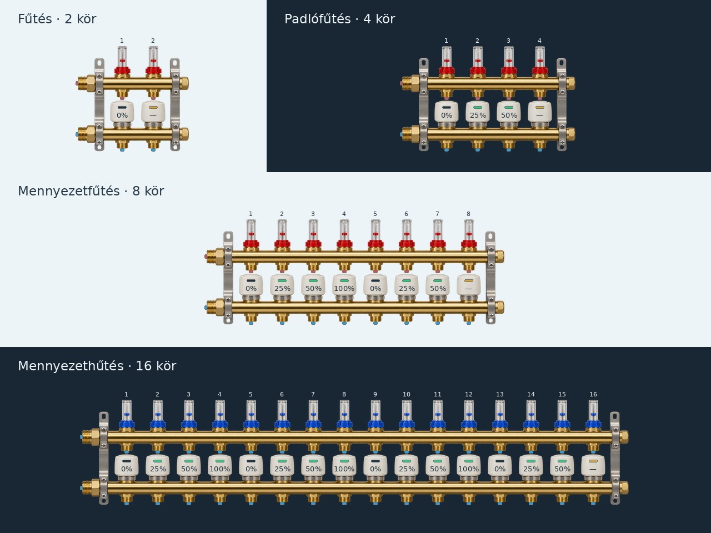

# Termofejes osztó-gyűjtők és forgatás

A szerkesztőben a **Termofejes osztó-gyűjtő (2–16 kör)** elemet válaszd. Egyetlen paraméterezhető elemtípus minden egész körszámot támogat 2 és 16 között. A két sín, az átfolyásmérők és a termofejek száma a körszámból készül; nincs tizenöt külön, eltérő pontosságú generált kép.

| Beállítás | Működés |
| --- | --- |
| Felhasználás | Fűtés, padlófűtés, mennyezetfűtés vagy mennyezethűtés. A felirat megkülönbözteti a változatokat; a hűtés előremenője kék. |
| Körszám | 2–16; változtatáskor az első megmaradó körök saját értéke és Loxone-hozzárendelése megmarad. A szélesség a körszámhoz igazodik, utána szabadon méretezhető. |
| Csőcsonkok és bekötési pontok | Kapcsolható csőbekötés; bekapcsolva két főcsatlakozás és minden körhöz egy előremenő, egy visszatérő végpont. 16 körnél 34 pont. |
| Körönkénti százalék | Kézzel 0–100%, vagy külön Loxone-állapot; a hozzárendelőben skálázás/eltolás is megadható. 0–1 forráshoz 100-as skála szükséges. |
| Sötét jelző | Ismert, 0%-os nyitási érték. |
| Zöld jelző | A kör ismert nyitási értéke szigorúan 0% fölött van. 0 és 0,5% között a felirat `<1%`, így pozitív jelhez nem társul 0%-os felirat. |
| Borostyán jelző és `—` | A hozzárendelt Loxone-érték hiányzik, érvénytelen vagy megszakadt a kapcsolat. A többi kör jelzése ettől független. |

A Loxone-értéket 0–100% közé korlátozzuk. A kézi érték hiányzó adatkapcsolat mellett is ismert marad; élő forráshoz nem használunk kézi tartalékértéket. A jelző a nyitási értéket szemlélteti, nem igazol mechanikai végállást vagy tényleges vízáramlást. A forrás hozzárendelése csak olvasás, nem szelepműködtetési parancs.

A csőcsonkok kikapcsolása vagy a körszám csökkentése leválasztja a megszűnő végpontokra kötött csöveket, de megtartja a megrajzolt csővonalat. A megmaradó csatlakozások követik a mozgatást, méretezést és forgatást. Az import mind a böngészőben, mind a firmware-ben elutasítja a nem létező vagy kikapcsolt végpontra mutató kötést.

## Forgatás

Minden eszköz, szöveg, értékmező és cső **0°, 90°, 180° vagy 270°** állásba forgatható a tulajdonságpanelen. A cső forgatása a töréspontjait forgatja el, és leválasztja a két korábbi kötést. A művelet visszavonható. Az oldalon el nem férő csőforgatást a szerkesztő elutasítja; az eszközök helyzetét szükség szerint a vászonra igazítja. A körszámok és a körönkénti százalékok olvashatóságuk érdekében vízszintesek maradnak.

## Grafika és ellenőrzés

Ez sematikus, pontos darabszámú műszaki grafika, nem egy konkrét márkájú osztó termékfotója. A firmware és a web ugyanazt a normalizált geometriát használja. A natív nézet a részeket LVGL-objektumokkal rajzolja; az SD-ről nem kell körszámonként külön képet betölteni.

Az előnézet a szerkesztő tényleges rajzelemeiből készül: `python3 tools/build_manifold_preview.py`. A 331 korábbi PNG-forrást tartalmazó [vizuális felülvizsgálat](grafika/vizualis-felulvizsgalat.md) ettől külön nyilvántartás.

A JavaScript-tesztek minden körszámot és felhasználást, a körönkénti állapotot és a csőforgatás pixelgeometriáját ellenőrzik. A C/JS validálás 214 paritásesete és a valódi LVGL-lel futó gazdagépes próba sikeres. A Chromium-próba ellenőrizte mind a 15 körszámot, a 34. port tényleges bekötését, a jelzőket, a forgatást, a csőleválasztást és a mentést/visszatöltést. Ezek gazdagépes ellenőrzések; fizikai P4-, Miniserver- és 20 FPS-mérés még szükséges.

A körönkénti futásidejű állapotok a P4 PSRAM-jában vannak; az animáció nem foglal dinamikus memóriát, és csak változott szöveget/színt ír vissza. A belső/DMA-pufferbeállítások és a 32 KiB tartalék változatlanok.

## Rögzített körszámú korábbi osztótípusok

A `manifold-2`–`manifold-10` és `manifold-12` stabil azonosítók megmaradnak. A hibás körszámú régi PNG-k helyett csomagoláskor pontos darabszámú statikus rajz készül. Két főcsonk után a korábbi sorrendű visszatérő pontok, majd az előremenő pontok következnek. A külön körönkénti százalékhoz és termofejjelzéshez továbbra is a **Termofejes osztó-gyűjtő (2–16 kör)** elemet válaszd.
