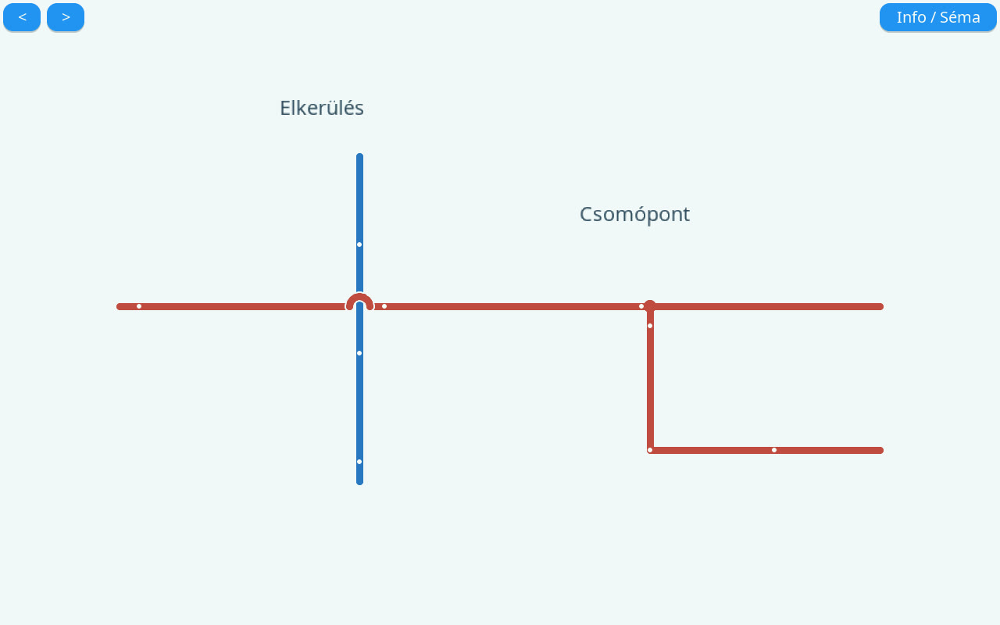

# Webfelület – elrendezés és Bootstrap-döntés

A készülék a HTML-, JavaScript- és CSS-fájlokat gzip-tömörítve, saját firmware-éből szolgálja ki. Az első beállítás és a helyi szerkesztés internet nélkül is használható kell maradjon. Ez a böngészőre vonatkozik: a firmware letöltéséhez továbbra is internet kell a készüléken.

## Megvizsgált lehetőségek

| Megoldás | Előny | Következmény ennél az eszköznél |
| --- | --- | --- |
| Bootstrap CSS/JS CDN-ről | Gyors bevezetés, kész komponensek | A böngészőnek külön el kell érnie a CDN-t. Új böngészőben vagy beállító AP mellett nem számíthatunk előzetesen gyorsítótárazott fájlra. A saját stílusokkal való ütközéseket is kezelni kell. |
| Helyben tárolt, szükséges részekre fordított Bootstrap | Internetfüggetlen, közös komponensrendszer | Új buildfüggőség, verzió- és licenckövetés, meglévő komponensek átvezetése. Későbbi nagyobb felületnél újravizsgálható. |
| Meglévő CSS Grid/Flex elrendezés rendezése | Kis helyi csomag, meglévő HU/EN és sötét mód megtartása | A projekthez tartozó néhány elrendezési szabályt saját tesztekkel karban kell tartani. |

**Döntés:** az MS1-ben a meglévő helyi stílusokat rendezzük. A Bootstrap nem szükséges a feltárt hibák javításához, CDN-függőség nem került a felületbe. Ez projektfüggő döntés, nem a Bootstrap általános elutasítása. A két saját stíluslap együtt körülbelül 4,1 kB gzip-adat.

Források: [Bootstrap – bevezetés és CDN](https://getbootstrap.com/docs/5.3/getting-started/introduction/), [Bootstrap – csak a szükséges Sass/JS részek és gzip](https://getbootstrap.com/docs/5.3/customize/optimize/).

## Elkészült rendezés

- Az oldalkezelés, mentés/import/export és az elemszerkesztés külön gombcsoportba került. A Mentés kiemelt, a romboló műveletek eltérő színt kapnak.
- Az elérhető elemek keresése és kategóriája feliratozott. A Tulajdonságok panel a megjelenést/méretet, értékeket, Loxone-adatokat és szelepállást külön mezőcsoportokba rendezi. Az elem fejlécében a lefordított típusnév látszik.
- 1280 px-től háromoszlopos szerkesztő; 760–1279 px között a tulajdonságok a vászon alá kerülnek; 760 px alatt egymás alatti panelek vannak. A navigáció telefonon saját sávjában görgethető, a dokumentum nem lóg ki oldalra.
- A beállítások Projekt, Kijelző és Wi-Fi csoportba kerültek. Az aktív navigációs pont minden oldalon megjelölt, képernyőolvasónak is.
- A fejléc, kártyák, mezők és támogatási blokk keskeny képernyőn is tördelődnek. A meglévő színpaletta és a rendszer sötét módja megmaradt.

## Szöveg- és értékmezők igazítása

A kijelölt Szöveg vagy Érték elemnél a Tulajdonságok → Megjelenés és méret → Szövegigazítás mezőben Balra, Középre és Jobbra választható. Az igazítás az elem saját szélességén belül érvényes, a teljes megjelenített értékre és mértékegységre együtt. A mező 90°-os forgatásakor az igazított szöveg is vele fordul. HU/EN feliratokkal a web és az LVGL-nézet egyaránt használja.

A projekt opcionális `align` mezője `left`, `center` vagy `right`. Hiányában a korábbi balra igazítás marad; a régi import nem kap kötelező új mezőt. A mező csak `text` és `value` elemen érvényes. Hibás érték, `null`, illetve csőre vagy készülékre tett igazítás a JS- és C-validátorban is elutasított. Az új igazítást tartalmazó exporthoz ezt támogató firmware szükséges; korábbi firmware az ismeretlen mezőt elutasítja.

Az igazítás mentésen, oldal-/projektexporton és újratöltésen át megmarad. Külön modellteszt, 48 új C/JS elfogadási/elutasítási eset, valódi Chromiumban mindkét elemtípus három igazítása és négy forgatása, valamint natív LVGL-ben az örökölt és három új igazítás 10/20/64-es betűmérettel és négy forgatással ellenőrzött. A meglévő betűkészlet, sortördelés és függőleges elhelyezés szabályai változatlanok.

## Ellenőrzés

A `tests/browser.mjs` 360, 390, 768, 1024, 1280 és 1920 px szélességen mind a nyolc útvonalat betölti, és ellenőrzi a dokumentum szélességét, aktív navigációját és a beállításcsoportokat. Külön angol, sötét mobilpróba nyit meg 16 körös osztót és Loxone-párosító párbeszédablakot. A teszt tiltja és hibának tekinti a külső erőforráskéréseket. A korábbi mentési, exportálási, párosítási és forgatási munkafolyamatok is lefutnak.

A natív HTTP-próba ellenőrzi a két stíluslap tényleges beágyazását, kibontását és CSS MIME-típusát. A gazdagépes böngésző-/HTTP-próba nem fizikai P4- vagy iOS Safari-próba; az MS1 hardveres és tartósüzemi feltételei nyitva maradnak.

## Egységes numerikus feliratok

A numerikus értékek és mértékegységek most azonos szabályokkal készülnek a weben és az LVGL-nézetben: 0–6 tizedes; félértéknél a nullától elfelé kerekítés; a kijelzett negatív nulla elhagyása; adathiánynál `—` a megtartott mértékegységgel. Üres egységnél nincs felesleges szóköz. 10⁹ abszolút értéktől hat értékes számjegyű exponenciális alak jelenik meg, így a szélsőséges bejövő számok felirata is korlátozott hosszú.

A Teljesítmény megjelenítése (%) felirat a megadott alsó/felső határhoz képesti, 0–100 közé korlátozott százalékot mutatja. Például 10–100 határ és 45-ös forrás esetén mindkét felület `39 %`-ot ír. Korábban a web a nyers forrásértéket írta, miközben a natív kijelző százalékot számolt. A kijelzett százalék nem változtat az explicit aktivitás elsőbbségén; a forrás leválasztása/adathiánya `— %`-ot eredményez.

A formázás 616 közös C/JS határesettel, a kerekítési/előjel/nagyságrendi szabályok egységtesztjével, tényleges böngészős és natív LVGL-feliratokkal ellenőrzött. Ez a numerikus szöveget egységesíti; a betűkészlet, sortördelés és pixelpontos függőleges elhelyezés külön vizuális regresszió marad.

## Csőkeresztezés és leágazás

Kattints két cső metszéspontjára, majd a **Tulajdonságok → Csőkeresztezés** mezőben válassz kapcsolatot. A régebbi sémák jelöletlen keresztezéseit is így állíthatod be.

- **Elkerülés** esetén az egyik vezeték kis ívvel halad át a másikon. Az ívet a kijelző és az áramlásjelző pontok is követik. A két kör külön vezérelhető.
- **Csomópont** esetén pont jelzi az összekötést. Az összefüggő csövek aktivitásjele, teljesítményforrása, teljesítménytartománya és áramlási iránya közös. Eltérő beállításoknál az összekötés előtt válaszd ki az átveendő csövet. Utána bármelyik csövön módosíthatod a közös beállítást. A szín és a vastagság csövenként szerkeszthető.
- **Leágazáshoz** kapcsold be a csőrajzolást, majd kattints a meglévő cső kívánt pontjára. A csatlakozási pontot a szerkesztő a vezetékre illeszti. Egy meglévő csőre kattintva be is fejezheted az új ágat. A leágazás mindig csomópont. Ha két külön hálózatot új csővel kötsz össze, a kezdő cső áramlásbeállítása érvényesül.
- Két áthaladó cső csomópontja visszaállítható elkerülésre. A két kör az addigi beállításokkal válik szét, ha másik csomópont nem köti őket össze. Ha közvetlenül az ívről indítasz ágat, a szerkesztő rákérdez, hogy mindhárom csövet össze szeretnéd-e kötni. Az átalakítás az új cső befejezésekor lép életbe.

[Importálható példa elkerüléssel és leágazással](../tests/schemas/csoaramlas/csomopont-es-elkerules.json)

